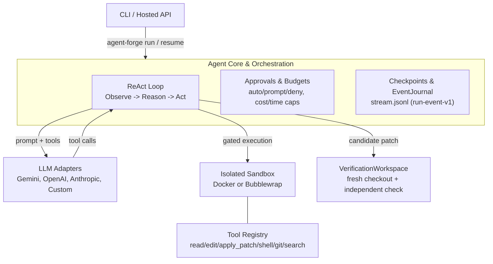
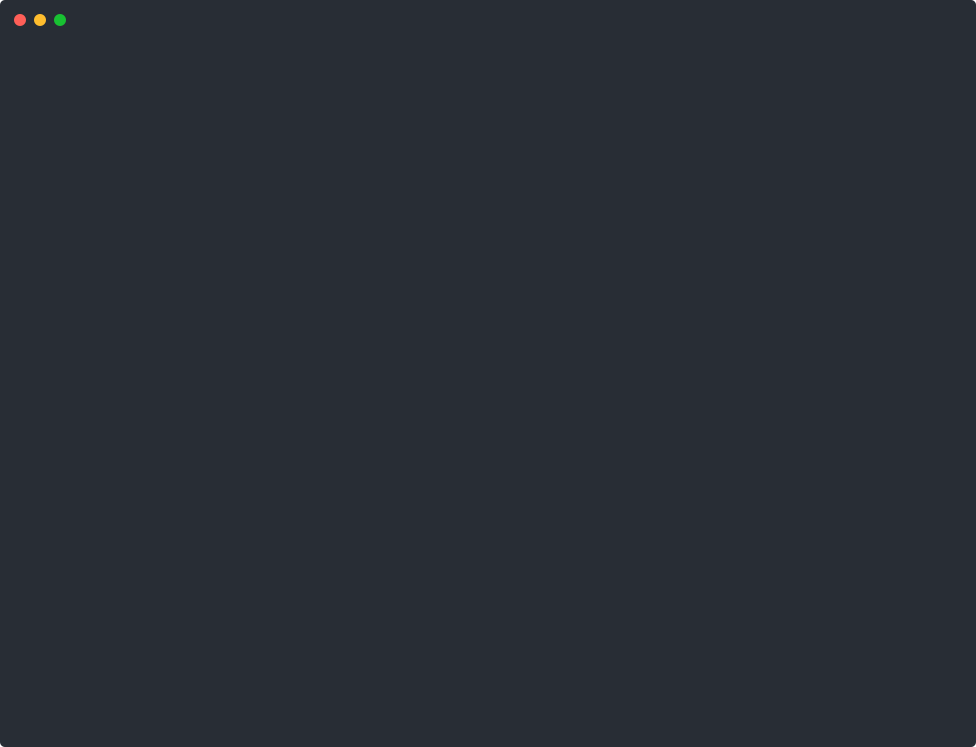

# Agent Forge

> Domain-agnostic AI coding harness — isolated Docker/Bubblewrap sandboxes, multi-provider model qualification, and independently verified patches.

[](https://github.com/akoita/agent-forge/actions/workflows/ci.yml)
[](https://github.com/akoita/agent-forge/actions/workflows/e2e-tests.yml)
[](LICENSE)
[](https://www.python.org/downloads/)
[](https://github.com/astral-sh/ruff)

---

## Overview

Agent Forge is a **small, measurable, high-correctness coding harness**. An agent executes the **ReAct** (Reasoning + Acting) loop against a pinned Git revision inside an isolated **Docker** or **Bubblewrap** sandbox, applies changes atomically, persists resumable checkpoints and typed lifecycle events, and verifies every candidate patch on a separate clean checkout.



### Key Features

- **Verified Local Patches** — Runs start from an isolated checkout of `HEAD`, export a clean `change.patch`, verify the patch on an independent checkout via `--verify-command`, and leave existing working-tree edits untouched.
- **Isolated Sandboxes** — Run every tool inside ephemeral Docker containers (`--network none`, CPU/memory/PID limits) or daemonless Linux Bubblewrap (`--sandbox-backend bwrap` or `auto`).
- **Atomic Patch & Git Tools** — Built-in file, shell, search, git workflow tools, and atomic multi-file `apply_patch` with pre-image checks and rollback.
- **Human-in-the-Loop Approvals** — Classify destructive operations (`rm`, `git push --force`, `git reset --hard`, `apply_patch` deletions) and enforce `--approval-mode auto|prompt|deny`.
- **Checkpointing, Budgets & Cancellation** — Save step-level checkpoints pinned to `base_revision`, enforce `--max-cost`, `--max-duration`, and `--max-tokens` (with `--budget-action timeout|pause`), and operate runs via `agent-forge resume` and `agent-forge cancel`.
- **Durable Typed Event Streaming** — Append sequence-indexed `run-event-v1` events to `stream.jsonl` and tail/reconnect losslessly via `agent-forge events --follow`, `status --follow`, or `GET /v1/runs/{run_id}/events` (JSON pagination and SSE with `Last-Event-ID`).
- **Model Qualification & Benchmarking** — Onboard models via `agent-forge.toml` profiles (`provider`, `model`, optional `base_url`, `api_key_env`, `temperature`), qualify tool calling and isolated fixes with `agent-forge models validate`, and measure verified fixes, latency, and cost (including failures) with `agent-forge models benchmark`.
- **Extensions & Hosted Service** — Domain features live outside core via Python entry-point plugins (`agent-forge init-extension`, `--profiles-dir`) and an optional authenticated FastAPI runner (`agent-forge serve`).

---

## Quick Start

### Prerequisites

- Python 3.11+
- Docker or Linux Bubblewrap (`bwrap`)
- An API key for Gemini (default), OpenAI, Anthropic, or an OpenAI-compatible endpoint

### Installation

```bash
git clone https://github.com/akoita/agent-forge.git
cd agent-forge

pip install -e ".[dev]"

# Optional: build the default Docker sandbox image (or use --sandbox-backend bwrap on Linux)
make build-sandbox

export GEMINI_API_KEY="your-key-here"
```

### Usage

```bash
# Run an isolated coding task and independently verify the resulting patch
agent-forge run \
  --task "Fix the failing /health check to return 200 OK" \
  --repo ./path/to/your/repo \
  --verify-command "python -m pytest -q" \
  --output-format json \
  --report-file ./artifacts/run-result.json

# Guard destructive actions and set spend/time budgets
agent-forge run \
  --task "Refactor the pagination helper" \
  --repo ./my-app \
  --approval-mode prompt \
  --max-cost 0.50 \
  --max-duration 300 \
  --budget-action pause

# Inspect, follow live events, resume, or cancel a run
agent-forge status <run-id> --output-format json
agent-forge events <run-id> --follow
agent-forge resume <run-id> --max-iterations 30
agent-forge cancel <run-id> --reason "Stopped by operator"
agent-forge list
agent-forge config

# Qualify and benchmark configured model profiles
agent-forge models validate gemini-flash-lite --live
agent-forge models benchmark --sandbox-backend bwrap --output-md docs/eval/report.md

# Run via queue worker (memory or redis) or hosted FastAPI server
agent-forge run --task "Fix login bug" --repo ./my-app --queue memory
agent-forge serve --host 127.0.0.1 --port 8000
```

### Demo

<p align="center">
  
</p>

<details>
<summary>Run the demo locally</summary>

```bash
# Watch the simulated demo
bash scripts/demo.sh

# Record a new asciinema cast
bash scripts/record-demo.sh
```

</details>

---

## Configuration

Agent Forge uses layered configuration (`CLI flags > env vars > ./agent-forge.toml > ~/.agent-forge/config.toml > defaults`).

Create an `agent-forge.toml` in your project root:

```toml
[agent]
max_iterations = 25
default_provider = "gemini"
default_model = "gemini-3.1-flash-lite-preview"
approval_mode = "auto"
budget_action = "timeout"

[sandbox]
backend = "docker"
memory_limit = "512m"
timeout_seconds = 300
network_enabled = false

[model_profiles.custom]
provider = "openai"
model = "meta-llama/Llama-4-Maverick-17B-128E-Instruct-FP8"
base_url = "https://api.together.xyz/v1"
api_key_env = "TOGETHER_API_KEY"
```

See the [Configuration Guide](docs/configuration.md) for all sections, environment variables, and model profiles, and the [Hosted Service Guide](docs/hosted-service.md) for API authentication, policy enforcement, streaming events, and deployment.

---

## Development

```bash
pip install -e ".[dev,redis]"

# Deterministic coding-grader checks (no provider credentials required)
make eval

# Fast unit tests (no Docker)
make test-unit

# Full test suite + coverage (excludes integration & e2e)
make test

# Docker integration tests & live E2E tests
make test-integration
make test-e2e

# Lint, type-check, boundary enforcement, and static quality checks
make lint
make format
make quality
python scripts/check_boundaries.py
python scripts/check_release.py
```

### Project Structure

```text
agent_forge/
├── agent/          # ReAct loop, state machine, approvals, budgets, checkpoints, verification
├── eval/           # Pinned coding benchmark corpus and runner
├── extensions/     # Extension SDK (entry-point discovery, scaffolding, prompt injection)
├── llm/            # Provider adapters (Gemini, OpenAI, Anthropic), factory, qualification
├── profiles/       # Generic agent profile loader
├── tools/          # Built-in tools (including apply_patch & git tools) + plugin loader
├── sandbox/        # Docker and Bubblewrap sandbox backends + factory
├── service/        # Hosted FastAPI service (runs, logs, SSE/JSON event stream, auth/policy)
├── orchestration/  # Task queues, EventBus, JournalEventSink, RunEventStream, workers
├── observability/  # Structured logging, trace context, pricing & cost tracking
├── cli.py          # Click CLI entrypoint
└── config.py       # Layered configuration models
plugins/
└── proof_of_audit/ # First-party domain extension (profiles, audit tools)
```

---

## Documentation

- **[Vision](docs/vision.md)** & **[Strategy](docs/strategy.md)** — Product goals, measurement principles, and ADR/RFC workflow.
- **[Roadmap](docs/roadmap.md)** & **[Delivery Plan](docs/delivery-plan.md)** — Milestone sequence and exit criteria.
- **[Latest Model Baseline](docs/eval/baseline-v0.4.0.md)** — Measured benchmark comparison and default model selection.
- **[Architecture](docs/architecture.md)** — Layer responsibilities and ReAct sequence.
- **[Configuration](docs/configuration.md)** — Config precedence, env vars, CLI flags, and model profiles.
- **[Hosted Service](docs/hosted-service.md)** — Hosted API, event streaming, trust boundaries, and operations.
- **[Testing](docs/testing.md)** — Deterministic graders, unit/integration/e2e tests, and coverage.
- **[Extending](docs/extending.md)** — Building domain extensions, custom tools, and provider adapters.
- **[Technical Spec](docs/spec.md)** — Full interface contracts and persistence schemas.

---

## Contributing

Contributions are welcome! Please read our [Contributing Guide](CONTRIBUTING.md) and [Code of Conduct](CODE_OF_CONDUCT.md) before submitting a pull request.

---

## Security

If you discover a security vulnerability, please follow our [Security Policy](SECURITY.md) for responsible disclosure.

---

## License

This project is licensed under the MIT License — see the [LICENSE](LICENSE) file for details.
