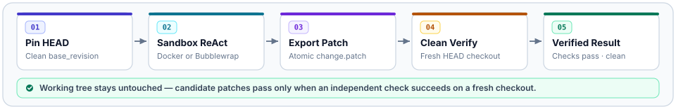
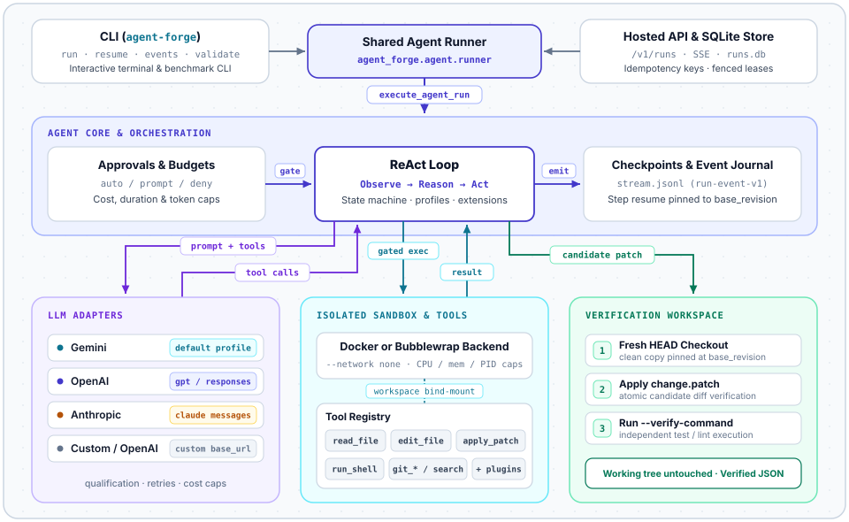

<div align="center">

<picture>
  <source media="(prefers-color-scheme: dark)" srcset="assets/banner-dark.svg" />
  <source media="(prefers-color-scheme: light)" srcset="assets/banner-light.svg" />
  
</picture>

<br /><br />

**Domain-agnostic AI coding harness** — isolated Docker & Bubblewrap sandboxes, multi-provider qualification, and independently verified patches.

<p>
  <a href="https://github.com/akoita/agent-forge/actions/workflows/ci.yml"></a>
  <a href="https://github.com/akoita/agent-forge/actions/workflows/e2e-tests.yml"></a>
  <a href="LICENSE"></a>
  <a href="https://www.python.org/downloads/"></a>
  <a href="https://github.com/astral-sh/ruff"></a>
</p>

[Demo](#demo) &middot; [Why Agent Forge](#why-agent-forge) &middot; [Workflow](#how-a-verified-run-works) &middot; [Architecture](#architecture) &middot; [Baseline](#measured-model-baseline) &middot; [Quick Start](#quick-start) &middot; [Docs](#documentation)

</div>

---

Agent Forge runs a **ReAct** (Observe &rarr; Reason &rarr; Act) coding agent against a pinned Git revision inside an isolated sandbox, records resumable checkpoints and typed events, and validates every candidate diff on a separate clean checkout before reporting success.

---

## Demo

<div align="center">
  
</div>

<details>
<summary>Run or re-record the demo locally</summary>

```bash
# Watch the scripted terminal demo
bash scripts/demo.sh

# Record a fresh cast and regenerate assets/demo.svg
bash scripts/record-demo.sh
```

</details>

---

## Why Agent Forge?

<table width="100%">
  <tr>
    <td width="50%" valign="top">
      <strong>Sandboxed by Default</strong><br />
      Every tool runs inside ephemeral Docker containers (<code>--network none</code>, CPU, memory, and PID limits) or daemonless Linux Bubblewrap (<code>--sandbox-backend bwrap</code>).
    </td>
    <td width="50%" valign="top">
      <strong>Independently Verified Patches</strong><br />
      Runs branch from a pinned <code>HEAD</code>, export <code>change.patch</code>, and run <code>--verify-command</code> on a fresh checkout while keeping your working tree untouched.
    </td>
  </tr>
  <tr>
    <td width="50%" valign="top">
      <strong>Multi-Provider &amp; Qualification</strong><br />
      First-class adapters for Gemini, OpenAI, Anthropic, and custom OpenAI-compatible endpoints, tested with <code>models validate</code> and <code>models benchmark</code>.
    </td>
    <td width="50%" valign="top">
      <strong>Resumable Runs &amp; Event Stream</strong><br />
      Step checkpoints stay pinned to <code>base_revision</code>, while sequence-indexed <code>run-event-v1</code> events append to <code>stream.jsonl</code> for CLI <code>--follow</code> or SSE clients.
    </td>
  </tr>
  <tr>
    <td width="50%" valign="top">
      <strong>Budget &amp; Approval Gates</strong><br />
      Cap cost, wall-clock duration, and tokens (<code>--budget-action timeout|pause</code>), and classify destructive operations under <code>--approval-mode auto|prompt|deny</code>.
    </td>
    <td width="50%" valign="top">
      <strong>Domain-Agnostic Extension Layer</strong><br />
      Core packages stay free of domain vocabulary (enforced in CI); vertical workflows load at runtime via Python entry-point plugins and <code>--profiles-dir</code>.
    </td>
  </tr>
</table>

---

## How a Verified Run Works

<picture>
  <source media="(prefers-color-scheme: dark)" srcset="assets/workflow-dark.svg" />
  <source media="(prefers-color-scheme: light)" srcset="assets/workflow-light.svg" />
  
</picture>

---

## Architecture

<picture>
  <source media="(prefers-color-scheme: dark)" srcset="assets/architecture-dark.svg" />
  <source media="(prefers-color-scheme: light)" srcset="assets/architecture-light.svg" />
  
</picture>

<br />

| Layer | Package | Responsibility |
| --- | --- | --- |
| **CLI & Hosted API** | `agent_forge.cli`, `agent_forge.service` | Click commands, authenticated FastAPI endpoints, SQLite `runs.db` leases, SSE streaming |
| **Shared Agent Runner** | `agent_forge.agent.runner` | Unified execution path shared by local CLI runs and hosted service workers |
| **Agent Core** | `agent_forge.agent`, `agent_forge.orchestration` | ReAct state machine, approval & budget gates, checkpoints, `stream.jsonl` journal |
| **LLM Adapters** | `agent_forge.llm`, `agent_forge.eval` | Gemini, OpenAI, Anthropic adapters, qualification probes, pinned benchmark corpus |
| **Sandbox & Tools** | `agent_forge.sandbox`, `agent_forge.tools` | Docker / Bubblewrap isolation, file/shell/search/git tools, atomic `apply_patch` |
| **Verification** | `agent_forge.agent.verification` | Independent checkout at `base_revision`, patch application, `--verify-command` runner |
| **Extension Layer** | `agent_forge.extensions`, `plugins/` | External profiles (`--profiles-dir`) and `agent_forge.tools` entry-point plugins |

---

## Measured Model Baseline

Measured across 4 pinned benchmark tasks (`fix-health-status`, `fix-pagination-offset`, `fix-multi-file-summary`, `fix-retry-backoff`) using `bwrap` sandboxes, `max_iterations=10`, `max_tokens_per_run=60000`, and `temperature=0.0` in [docs/eval/baseline-v0.4.0.md](docs/eval/baseline-v0.4.0.md).

| Profile | Provider | Model | Verified | Median Latency | Total Cost (incl. failures) | Notes |
| --- | --- | --- | --- | --- | --- | --- |
| `gemini-flash-lite` | gemini | `gemini-3.1-flash-lite-preview` | **1/4 (25%)** | 113.28s | `$0.027518` | Selected default (`0` rate limits) |
| `gemini-25-flash` | gemini | `gemini-2.5-flash` | 0/4 (0%) | 73.72s | `$0.017782` | Hit iteration cap / rate limits |
| `gemini-3-flash` | gemini | `gemini-3-flash-preview` | 0/4 (0%) | 70.92s | `$0.036208` | Hit iteration cap / rate limits |
| `openai-gpt54`, `anthropic-sonnet`, `meta-llama` | — | Configured in `agent-forge.toml` | — | — | — | Skipped in baseline run (API keys unset) |

<details>
<summary>Reproduce the multi-profile benchmark</summary>

```bash
agent-forge models benchmark \
  --sandbox-backend bwrap \
  --attempts 1 \
  --max-iterations 10 \
  --max-tokens 60000 \
  --output-json docs/eval/baseline-v0.4.0.json \
  --output-md docs/eval/baseline-v0.4.0.md
```

</details>

---

## Quick Start

### Prerequisites

- **Python 3.11+**
- **Docker** or daemonless Linux **Bubblewrap (`bwrap`)**
- An API key for Gemini (default), OpenAI, Anthropic, or an OpenAI-compatible endpoint

### Install

```bash
git clone https://github.com/akoita/agent-forge.git
cd agent-forge

# Minimal CLI + sandbox runtime
pip install -e .

# Optional extras: hosted API ([service]), artifact store ([gcs]), Redis queue ([redis]), dev tools ([dev])
pip install -e ".[dev,service,gcs,redis]"

# Build the default Docker sandbox image (skip if using --sandbox-backend bwrap on Linux)
make build-sandbox

export GEMINI_API_KEY="your-key-here"
```

### Run an Independently Verified Fix

```bash
agent-forge run \
  --task "Fix the failing /health check to return 200 OK" \
  --repo ./path/to/your/repo \
  --verify-command "python -m pytest -q" \
  --output-format json \
  --report-file ./artifacts/run-result.json
```

<details>
<summary><strong>Budgets &amp; approval gates</strong> — cap cost/time and guard destructive commands</summary>

```bash
agent-forge run \
  --task "Refactor the pagination helper" \
  --repo ./my-app \
  --approval-mode prompt \
  --max-cost 0.50 \
  --max-duration 300 \
  --budget-action pause
```

</details>

<details>
<summary><strong>Inspect, follow, resume &amp; cancel runs</strong> — tail <code>stream.jsonl</code> or resume from checkpoint</summary>

```bash
agent-forge status <run-id> --output-format json
agent-forge events <run-id> --follow
agent-forge resume <run-id> --max-iterations 30
agent-forge cancel <run-id> --reason "Stopped by operator"
agent-forge list
agent-forge config
```

</details>

<details>
<summary><strong>Qualify &amp; benchmark models</strong> — probe tool calling before switching default profiles</summary>

```bash
agent-forge models validate gemini-flash-lite --live
agent-forge models benchmark --sandbox-backend bwrap --output-md docs/eval/report.md
```

</details>

<details>
<summary><strong>Queue worker &amp; hosted FastAPI service</strong> — asynchronous execution and SSE streaming</summary>

```bash
# Run via local in-memory or Redis task queue
agent-forge run --task "Fix login bug" --repo ./my-app --queue memory

# Start the hosted API server (/v1/runs, /v1/runs/{run_id}/events SSE)
agent-forge serve --host 127.0.0.1 --port 8000
```

</details>

---

## Configuration

Agent Forge uses layered configuration with the precedence `CLI flags > env vars > ./agent-forge.toml > ~/.agent-forge/config.toml > defaults`.

```toml
[agent]
max_iterations = 25
default_provider = "gemini"
default_model = "gemini-3.1-flash-lite-preview"
approval_mode = "auto"
budget_action = "timeout"

[sandbox]
backend = "docker"
memory_limit = "512m"
timeout_seconds = 300
network_enabled = false

[model_profiles.custom]
provider = "openai"
model = "meta-llama/Llama-4-Maverick-17B-128E-Instruct-FP8"
base_url = "https://api.together.xyz/v1"
api_key_env = "TOGETHER_API_KEY"
```

See the [Configuration Guide](docs/configuration.md) for all sections and environment variables, and the [Hosted Service Guide](docs/hosted-service.md) for API keys, workspace source limits, and streaming setup.

---

## Development &amp; Project Structure

```bash
# Deterministic coding-grader eval (no provider credentials required)
make eval

# Fast unit tests & full non-E2E suite with coverage
make test-unit
make test

# Docker integration & live E2E suites
make test-integration
make test-e2e

# Formatting, lint, type-check, static quality & core boundary check
make format
make lint
make quality
python scripts/check_boundaries.py
python scripts/check_release.py
```

```text
agent_forge/
├── agent/          # ReAct loop, runner.py, state machine, approvals, budgets, checkpoints, verification
├── eval/           # Pinned coding benchmark corpus and runner
├── extensions/     # Extension SDK (entry-point discovery, scaffolding, prompt injection)
├── llm/            # Provider adapters (Gemini, OpenAI, Anthropic), factory, qualification
├── profiles/       # Generic agent profile loader
├── tools/          # Built-in tools (including apply_patch & git tools) + plugin loader
├── sandbox/        # Docker and Bubblewrap sandbox backends + factory
├── service/        # Hosted FastAPI service (app.py, store.py, SSE/JSON event stream, auth/policy)
├── orchestration/  # Task queues, EventBus, JournalEventSink, RunEventStream, workers
├── observability/  # Structured logging, trace context, pricing & cost tracking
├── cli.py          # Click CLI entrypoint
└── config.py       # Layered configuration models
plugins/
└── proof_of_audit/ # First-party domain extension (profiles, audit tools)
```

---

## Documentation

| Category | Document | Focus |
| --- | --- | --- |
| **Direction** | [Vision](docs/vision.md) &middot; [Strategy](docs/strategy.md) &middot; [Roadmap](docs/roadmap.md) &middot; [Delivery Plan](docs/delivery-plan.md) | Product direction, measurement principles, and milestone exit criteria |
| **Design** | [Architecture](docs/architecture.md) &middot; [Technical Spec](docs/spec.md) &middot; [Documentation Format](docs/documentation-format.md) | Component layers, ReAct sequence, contracts, and doc conventions |
| **Decisions** | [ADRs](docs/adr) &middot; [RFCs](docs/rfcs) | Architecture decision records (`001`–`004`) and technical proposals (`001`–`002`) |
| **Evaluation** | [Model Baseline (v0.4.0)](docs/eval/baseline-v0.4.0.md) | Measured benchmark scores, latency, cost, and default selection rationale |
| **Operations** | [Configuration](docs/configuration.md) &middot; [Hosted Service](docs/hosted-service.md) &middot; [Testing](docs/testing.md) &middot; [Extending](docs/extending.md) | Config precedence, hosted runner operations, test suites, and plugins |

---

## Contributing &amp; Community

- **Contributing:** Read the [Contributing Guide](CONTRIBUTING.md) and [Code of Conduct](CODE_OF_CONDUCT.md) before opening a pull request.
- **Security:** Report vulnerabilities responsibly by following the [Security Policy](SECURITY.md).
- **License:** Released under the [MIT License](LICENSE).
