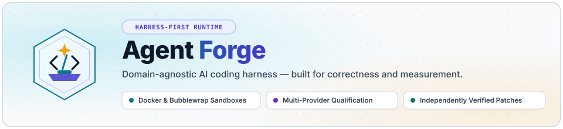

<div align="center">

<picture>
  <source media="(prefers-color-scheme: dark)" srcset="assets/banner-dark.svg" />
  <source media="(prefers-color-scheme: light)" srcset="assets/banner-light.svg" />
  
</picture>

<br /><br />

**High-correctness coding harness &amp; multi-agent runtime** — isolated sandboxes, **Code Mode**, bounded subagents, full **ACP** IDE interop, **Agent Forge Studio**, and independently verified patches.

<p>
  <a href="https://github.com/akoita/agent-forge/actions/workflows/ci.yml"></a>
  <a href="https://github.com/akoita/agent-forge/actions/workflows/e2e-tests.yml"></a>
  <a href="LICENSE"></a>
  <a href="https://www.python.org/downloads/"></a>
  <a href="https://github.com/astral-sh/ruff"></a>
</p>

[Demo](#demo) &middot; [Why Agent Forge](#why-agent-forge) &middot; [Workflow](#how-a-verified-run-works) &middot; [Architecture](#architecture) &middot; [Baseline &amp; Models](#measured-harness-baseline--frontier-models) &middot; [Quick Start](#quick-start) &middot; [Docs](#documentation)

</div>

---

Agent Forge executes a **ReAct** or programmatic **Code Mode** coding agent against a pinned Git revision inside an isolated Docker or Bubblewrap sandbox, supports **Git worktree-isolated subagents** and durable `.agent-forge/memory.md`, speaks standard **[Agent Client Protocol (ACP)](https://agentclientprotocol.com/get-started/introduction)** & **MCP**, ships with **Agent Forge Studio** (`apps/studio/`), and validates every candidate patch on a clean independent checkout.

---

## Demo

<div align="center">
  
</div>

<details>
<summary>Run or re-record the demo locally</summary>

```bash
# Watch the scripted terminal demo
bash scripts/demo.sh

# Record a fresh cast and regenerate assets/demo.svg
bash scripts/record-demo.sh
```

</details>

---

## Why Agent Forge?

<table width="100%">
  <tr>
    <td width="50%" valign="top">
      <strong>Sandboxed &amp; Independently Verified</strong><br />
      Tools execute in ephemeral Docker containers (<code>--network none</code>, CPU/memory/PID caps, <code>.devcontainer</code>/<code>mise</code> support) or Linux Bubblewrap (<code>bwrap</code>), with host-brokered auth and clean-checkout <code>--verify-command</code> grading.
    </td>
    <td width="50%" valign="top">
      <strong>SOTA Loop: Code Mode, Subagents &amp; Worktrees</strong><br />
      Combine standard ReAct with programmatic <code>execute_code</code> (<strong>Code Mode</strong>), bounded hierarchical <code>spawn_subagent</code> workers on isolated Git worktrees, tree-sitter symbol/diagnostics loops, and deterministic <code>.agent-forge/memory.md</code>.
    </td>
  </tr>
  <tr>
    <td width="50%" valign="top">
      <strong>Frontier Multi-Provider Support (Nov 2026)</strong><br />
      First-class adapters for <strong>Gemini 4</strong> (<code>Hydrogen</code>, <code>Neon</code>, <code>Carbon</code>, <code>Argon</code>), <strong>OpenAI</strong> (<code>GPT-6.2 Sol</code>/<code>Astra</code> via <code>/v1/responses</code>), <strong>Anthropic</strong> (<code>Claude 5.5</code> &amp; <code>Fable 5.2</code>), <strong>OpenRouter</strong>, and local <code>Ollama</code>/<code>vLLM</code>.
    </td>
    <td width="50%" valign="top">
      <strong>Full ACP Standard &amp; Agent Forge Studio</strong><br />
      Spec-conformant ACP over <code>stdio</code>, authenticated WebSocket (<code>/ws/acp</code>), and Registry <code>agent.json</code> for Zed/JetBrains/Neovim — plus built-in React + Monaco <code>DiffEditor</code> + <code>xterm.js</code> Web IDE via <code>agent-forge studio</code>.
    </td>
  </tr>
  <tr>
    <td width="50%" valign="top">
      <strong>Durable Sessions, Budgets &amp; Approval Gates</strong><br />
      Resumable <code>DevSession</code> snapshots with context compaction, append-only <code>run-event-v1</code> journals &amp; SSE streams, hard USD/token/time caps, and declarative approval hooks (<code>auto|prompt|deny</code>) + egress proxy.
    </td>
    <td width="50%" valign="top">
      <strong>Domain-Agnostic Core &amp; Multi-Agent Cloud Track</strong><br />
      Mechanically enforced extension boundary (<code>scripts/check_boundaries.py</code>), cloud/EVM extension packs (<code>plugins/</code>), and active milestones for the Router–Worker <strong>Super-Agent</strong> and <strong>Managed Multi-Agent Cloud Platform</strong> (<a href="docs/adr/031-multi-agent-cloud-platform-and-super-agent.md">ADR-031</a>).
    </td>
  </tr>
</table>

---

## How a Verified Run Works

<picture>
  <source media="(prefers-color-scheme: dark)" srcset="assets/workflow-dark.svg" />
  <source media="(prefers-color-scheme: light)" srcset="assets/workflow-light.svg" />
  
</picture>

---

## Architecture

<picture>
  <source media="(prefers-color-scheme: dark)" srcset="assets/architecture-dark.svg" />
  <source media="(prefers-color-scheme: light)" srcset="assets/architecture-light.svg" />
  
</picture>

<br />

| Layer | Package | Responsibility |
| --- | --- | --- |
| **CLI, ACP &amp; Studio** | `agent_forge.cli`, `agent_forge.acp`, `apps/studio/` | Click CLI (`run`, `chat`, `studio`, `acp`, `models`), spec-valid ACP (`stdio` + `/ws/acp`), React + Monaco + `xterm.js` Web UI |
| **Hosted API** | `agent_forge.service`, `agent_forge.agent.runner` | Unified runner contract, authenticated FastAPI `/v1/runs` endpoints, SQLite leases, SSE streaming |
| **Agent Core** | `agent_forge.agent`, `agent_forge.orchestration` | ReAct & Code Mode loop, subagents, worktrees, approvals, budgets, context compaction, `.agent-forge/memory.md`, `stream.jsonl` |
| **LLM Adapters** | `agent_forge.llm`, `agent_forge.eval` | Gemini, OpenAI (`/v1/responses`), Anthropic, OpenRouter, Ollama/vLLM, capability negotiation, 12-task eval corpus |
| **Sandbox &amp; Tools** | `agent_forge.sandbox`, `agent_forge.tools` | Docker / Bubblewrap isolation, `.devcontainer`/`mise`, MCP tools, tree-sitter symbols/diagnostics, atomic `apply_patch` |
| **Verification** | `agent_forge.agent.verification` | Independent checkout at `base_revision`, patch application, `--verify-command` grading |
| **Extension Layer** | `agent_forge.extensions`, `plugins/` | External profiles (`--profiles-dir`), `plugins/cloud-deploy/`, `plugins/evm-foundry/`, `agent_forge.tools` plugins |

---

## Measured Harness Baseline &amp; Frontier Models

### 1. v0.8.0 Paired Deterministic Baseline (12-Task Corpus)

Measured in CI across 12 independent coding tasks comparing standard `tool_calling`, **Code Mode**, and **Subagents**, alongside `noop` and `incomplete` negative controls ([docs/eval/baseline-v0.8.0.md](docs/eval/baseline-v0.8.0.md)):

| Profile | Mode | Verified | Median Latency | Mean Tokens / Task | Tool Error Rate | Outcome |
| --- | --- | --- | --- | --- | --- | --- |
| `deterministic-oracle` | `tool_calling` | **12/12 (100%)** | `0.56s` | `655` | `32.4%` | Reference patch passes independent check |
| `deterministic-oracle-code-mode` | `code_mode` | **12/12 (100%)** | `0.58s` | **`260` (~60% fewer)** | **`24.5%`** | Programmatic tool chaining passes with lower token overhead |
| `deterministic-oracle-subagents` | `subagents` | **12/12 (100%)** | `0.65s` | `855` | `32.4%` | Isolated worktree delegation preserves parent correctness |
| `deterministic-noop` / `incomplete` | negative controls | **0/12 (0%)** | `0.27s`–`0.38s` | `315`–`485` | `0.0%` | **0% false positives** (`empty_patch` / `check_failed`) |

### 2. Frontier Model Profiles (Nov 2026)

Configured in [agent-forge.toml](agent-forge.toml) for live qualification and benchmarking across current frontier families:

| Profile | Provider | Model ID | Context | Role |
| --- | --- | --- | --- | --- |
| `gemini-4-hydrogen` *(default)* | `gemini` | `gemini-4-hydrogen` | `1M` | Fast daily-driver coding &amp; high-efficiency agent/subagent worker |
| `gemini-4-neon` | `gemini` | `gemini-4-neon` | `1M` | Balanced frontier engineering &amp; end-to-end execution |
| `gemini-4-carbon` / `gemini-4-argon` | `gemini` | `gemini-4-carbon` / `gemini-4-argon` | `1M` | Heavy deep-reasoning &amp; long-horizon architecture/debugging |
| `gemini-38-flash` | `gemini` | `gemini-3.8-flash` | `1M` | Active Gemini 3.8 Flash workhorse |
| `openai-gpt62-sol` | `openai` | `gpt-6.2-sol` | `1.05M` | OpenAI primary coding workhorse via `/v1/responses` |
| `openai-gpt62-astra` | `openai` | `gpt-6.2-astra` | `1.05M` | OpenAI flagship multi-file &amp; complex logic model |
| `anthropic-sonnet55` | `anthropic` | `claude-sonnet-5-5` | `1M` | Fast high-throughput coding &amp; agentic execution |
| `anthropic-opus55` / `anthropic-fable52` | `anthropic` | `claude-opus-5-5` / `claude-fable-5-2` | `1M` | Heavy architecture, migrations, and adaptive thinking |
| `meta-llama` | `openai-compatible` | `meta-llama/Llama-4-Maverick-17B-128E-Instruct-FP8` | `128K+` | Open-weights candidate via Together / local Ollama / vLLM |

<details>
<summary>Run live model qualification or reproduce the deterministic benchmark (plus historical v0.4.0 archive)</summary>

```bash
# Probe a frontier profile with your API key
agent-forge models validate gemini-4-hydrogen --live
agent-forge models validate openai-gpt62-sol --live
agent-forge models validate anthropic-sonnet55 --live

# Run deterministic 12-task CI suite (no API key needed)
python -m agent_forge.eval --suite full --include-paired --assert-gates

# Benchmark configured live profiles in Bubblewrap sandboxes
agent-forge models benchmark --sandbox-backend bwrap --attempts 1 --output-md docs/eval/report.md
```

- Historical reference: [docs/eval/baseline-v0.4.0.md](docs/eval/baseline-v0.4.0.md) archives the initial v0.4.0 live baseline (`gemini-3.1-flash-lite-preview`, `gemini-2.5-flash`, `gemini-3-flash-preview` — legacy IDs since retired or superseded by Gemini 4).

</details>

---

## Quick Start

### Prerequisites

- **Python 3.11+** (and **Node.js 22+** to build/develop `apps/studio/`)
- **Docker** or daemonless Linux **Bubblewrap (`bwrap`)**
- An API key for Gemini (default), OpenAI, Anthropic, OpenRouter, or a local OpenAI-compatible server

### Install

```bash
git clone https://github.com/akoita/agent-forge.git
cd agent-forge

# Minimal CLI + sandbox runtime
pip install -e .

# Optional extras: hosted/Studio bridge ([service]), GCS ([gcs]), Redis ([redis]), dev tools ([dev])
pip install -e ".[dev,service,gcs,redis]"

# Build the default Docker sandbox image (skip if using --sandbox-backend bwrap on Linux)
make build-sandbox

export GEMINI_API_KEY="your-key-here"
```

### Run Verified Fixes, Interactive Chat, Studio Web IDE &amp; ACP

```bash
# 1. Independently verified CLI fix
agent-forge run \
  --task "Fix the failing /health check to return 200 OK" \
  --repo ./path/to/your/repo \
  --verify-command "python -m pytest -q" \
  --output-format json \
  --report-file ./artifacts/run-result.json

# 2. Interactive durable development session (with /diff, /undo, /sessions, /memory)
agent-forge chat --repo ./path/to/your/repo --subagents

# 3. Launch Agent Forge Studio (React + Monaco DiffEditor + xterm.js + ACP)
export AGENT_FORGE_ACP_TOKEN="local-dev-secret"
(cd apps/studio && npm install && npm run build)
agent-forge studio --workspace ./path/to/your/repo

# 4. Expose standard ACP stdio server for Zed, JetBrains, or Neovim (see docs/acp-ide-interop.md)
agent-forge acp
```

<details>
<summary><strong>Budgets, Code Mode &amp; approval gates</strong> — cap cost/time and guard destructive actions</summary>

```bash
agent-forge run \
  --task "Refactor the pagination helper" \
  --repo ./my-app \
  --execution-mode code_mode \
  --approval-mode prompt \
  --max-cost 0.50 \
  --max-duration 300 \
  --budget-action pause
```

</details>

<details>
<summary><strong>Inspect, follow, resume &amp; cancel runs</strong> — tail <code>stream.jsonl</code> or resume from checkpoint</summary>

```bash
agent-forge status <run-id> --output-format json
agent-forge events <run-id> --follow
agent-forge resume <run-id> --max-iterations 30
agent-forge cancel <run-id> --reason "Stopped by operator"
agent-forge sessions list
agent-forge memory list --repo ./my-app
```

</details>

<details>
<summary><strong>Queue worker &amp; hosted FastAPI service</strong> — asynchronous execution and SSE streaming</summary>

```bash
# Run via local in-memory or Redis task queue with isolated Git worktrees
agent-forge run --task "Fix login bug" --repo ./my-app --queue memory

# Start the hosted API server (/v1/runs, /v1/runs/{run_id}/events SSE)
agent-forge serve --host 127.0.0.1 --port 8000
```

</details>

---

## Configuration

Agent Forge uses layered configuration with the precedence `CLI flags > env vars > ./agent-forge.toml > ~/.agent-forge/config.toml > defaults`.

```toml
[agent]
max_iterations = 25
default_provider = "gemini"
default_model = "gemini-4-hydrogen"
approval_mode = "auto"
execution_mode = "tool_calling"  # or "code_mode"
budget_action = "timeout"

[sandbox]
backend = "docker"
memory_limit = "512m"
timeout_seconds = 300
network_enabled = false

[model_profiles.frontier-reasoning]
provider = "anthropic"
model = "claude-fable-5-2"
```

See the [Configuration Guide](docs/configuration.md) for all sections and environment variables, and the [Hosted Service Guide](docs/hosted-service.md) for API keys, workspace source limits, and streaming setup.

---

## Development &amp; Project Structure

```bash
# Deterministic 12-task coding-grader eval (no provider credentials required)
make eval

# Fast unit tests & full non-E2E suite with coverage
make test-unit
make test

# Agent Forge Studio checks & Playwright Chromium E2E
(cd apps/studio && npm run typecheck && npm run test && npm run build && npm run test:e2e)

# Formatting, lint, type-check, static quality & core boundary check
make format
make lint
make quality
python scripts/check_boundaries.py
python scripts/check_release.py
```

```text
agent_forge/
├── acp/            # Spec-validated ACP server (stdio + WebSocket/Workspace/PTY bridge)
├── agent/          # ReAct & Code Mode loop, subagents, DevSession, memory, checkpoints, verification
├── auth/           # Host-side credential store and egress/auth brokering
├── eval/           # Pinned 12-task coding benchmark corpus and paired runner
├── extensions/     # Extension SDK (entry-point discovery, scaffolding, prompt injection)
├── llm/            # Gemini 4, OpenAI (/v1/responses), Anthropic, OpenRouter, capability & model router
├── profiles/       # Generic agent profile loader
├── tools/          # File/shell/search/git, apply_patch, execute_code, tree-sitter symbols & MCP tools
├── sandbox/        # Docker and Bubblewrap backends + .devcontainer/mise setup
├── service/        # Hosted FastAPI service (/v1/runs, SQLite leases, SSE streaming, auth)
├── orchestration/  # Task queues, Git worktrees, EventBus, RunEventStream, workers
├── observability/  # Structured logging, trace context, pricing & cost tracking
├── cli.py          # Click CLI entrypoint (run, chat, studio, acp, serve, models, sessions, memory)
└── config.py       # Layered configuration models
apps/
└── studio/         # React + Vite + Monaco (DiffEditor) + xterm.js ACP Web Code Editor
plugins/
├── cloud-deploy/   # GCP / AWS / Terraform deployment extension pack
├── evm-foundry/    # Smart-contract / Foundry extension pack
└── proof_of_audit/ # First-party domain extension pack
```

---

## Documentation

| Category | Document | Focus |
| --- | --- | --- |
| **Direction** | [Vision](docs/vision.md) &middot; [Strategy](docs/strategy.md) &middot; [Roadmap](docs/roadmap.md) &middot; [Delivery Plan](docs/delivery-plan.md) | Managed Multi-Agent Cloud Platform vision, Super-Agent roadmap (`#248`–`#255`), and milestones |
| **Design** | [Architecture](docs/architecture.md) &middot; [Technical Spec](docs/spec.md) &middot; [ACP IDE Interop](docs/acp-ide-interop.md) | Component layers, ReAct/Code Mode sequence, ACP Registry `agent.json`, and Studio guides |
| **Decisions** | [ADRs](docs/adr) &middot; [RFCs](docs/rfcs) | Architecture decision records (`001`–`031`) and technical proposals (`001`–`005`) |
| **Evaluation** | [Paired Baseline (v0.8.0)](docs/eval/baseline-v0.8.0.md) &middot; [Archive (v0.4.0)](docs/eval/baseline-v0.4.0.md) | Measured 12-task deterministic paired baseline &amp; archived initial live probe |
| **Operations** | [Configuration](docs/configuration.md) &middot; [Hosted Service](docs/hosted-service.md) &middot; [Testing](docs/testing.md) &middot; [Extending](docs/extending.md) | Config precedence, hosted runner operations, Playwright/pytest suites, and plugins |

---

## Contributing &amp; Community

- **Contributing:** Read the [Contributing Guide](CONTRIBUTING.md) and [Code of Conduct](CODE_OF_CONDUCT.md) before opening a pull request.
- **Security:** Report vulnerabilities responsibly by following the [Security Policy](SECURITY.md).
- **License:** Released under the [MIT License](LICENSE).
