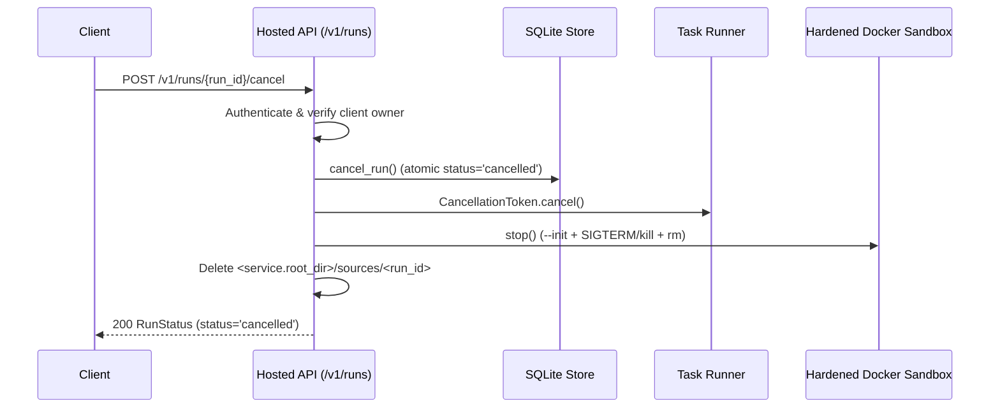

# ADR 005 — Qualify hardened Docker sandbox for invite-only hosted pilot

**Status:** Proposed · 2026-11-22

## Context

The invite-only hosted pilot ([#157](https://github.com/akoita/agent-forge/issues/157)) executes untrusted repositories triggered by external API clients on a shared service host. Before onboarding pilot users, the harness must verify six isolation gates per backend: workspace separation, credential scrubbing, blocked egress, resource caps, fast cancellation, and zero-leak cleanup.

Existing local defaults had three gaps under real qualification testing:

- Containers lacked `cap_drop=["ALL"]` and `--init`, causing `sleep infinity` PID 1 to ignore `SIGTERM` and take `5.34s` to stop.
- Bubblewrap left `/` writable without `--remount-ro /` and lacked `--clearenv`, cgroup resource limits, and `/tmp` `noexec`.
- The hosted API lacked a `POST /v1/runs/{run_id}/cancel` endpoint to stop active sandboxes and purge ephemeral workspaces on abort.

## Decision for review

Qualify the hardened `DockerSandbox` backend (`agent-forge-sandbox:latest`) **only for single-tenant and invite-only hosted pilot deployments** controlled by `service.clients_path`. Keep `BwrapSandbox` restricted to local Linux development and CI, and require kernel or VM-level isolation before running untrusted multi-tenant SaaS workloads.

Specifically, enforce these controls across core and hosted mode:

- **Container hardening:** `DockerSandbox` runs with `--network none`, `--read-only`, `--cap-drop=ALL`, `--security-opt no-new-privileges`, `--init`, `--pids-limit 256`, CPU/memory cgroup limits, `--tmpfs /tmp:rw,noexec,nosuid`, `sanitize_sandbox_env()`, and `container.remove(force=True)` fallback.
- **Process isolation hardening:** `BwrapSandbox` uses `--clearenv`, empty host subprocess `env={}`, `--remount-ro /`, `--unshare-net`, and tracks child processes to reap on `asyncio.CancelledError` or `stop()`.
- **Hosted cancellation:** `POST /v1/runs/{run_id}/cancel` verifies API key and client ownership, atomically transitions SQLite state to `cancelled`, cancels the `CancellationToken`, stops the active sandbox, and removes only the run's ephemeral directory under `<service.root_dir>/sources/`.
- **Automated qualification gate:** `agent_forge/sandbox/qualification.py` (`qualify_sandbox_backend`) runs all six checks live in CI against built images (`tests/integration/test_sandbox_qualification_integration.py`).

## Alternatives and consequences

| Option | Workspace & Egress | Creds & Caps | Cancel & Cleanup | Hosted Verdict |
| --- | --- | --- | --- | --- |
| **Hardened `DockerSandbox`** (chosen for pilot) | Bind-mounted `/workspace`, ro rootfs, `--network none` | `sanitize_sandbox_env`, `cap_drop=ALL`, CPU/RAM/PID cgroups, `/tmp` `noexec` | `--init`, `0.30s` stop, `--rm` + force remove | **Qualified for single-tenant & invite-only pilot**; shares host Docker socket boundary |
| **`BwrapSandbox`** (local/CI only) | `--remount-ro /`, `--unshare-net`, ro system dirs | `--clearenv` + `env={}`, but **no cgroups** and `/tmp` allows exec | `0.21s` `kill()`, zero child procs | **Disqualified for shared hosted use** (`resource_limits` fails) |
| **gVisor (`--runtime=runsc`)** | User-space kernel syscall boundary | Full Docker cgroups + reduced kernel attack surface | Same container lifecycle | **Deferred** until pilot scales past trusted invitees |
| **GCP Cloud Run Jobs / per-run VM** | Hardware VM boundary per run, zero shared socket | Per-job IAM + VPC Service Controls + GCP quotas | Job execution cancel + VM tear-down | **Target architecture** for untrusted multi-tenant SaaS |

Choosing hardened Docker unblocks the invite-only pilot immediately on existing VM topology without introducing new daemon dependencies. The trade-off is that `docker.sock` remains a root-equivalent host trust boundary, so every pilot tenant must remain explicitly allowlisted in `service.clients_path`. Moving to gVisor or Cloud Run Jobs requires changes only inside the IaC runtime and `Sandbox` factory, leaving runner and API contracts unchanged.

## Observed qualification evidence

Live execution of `qualify_sandbox_backend` on Linux (Python `3.13.6`, Docker `28.3.3` with `agent-forge-sandbox:latest`, and `bwrap` `0.9.0`):

| Check | Hardened `docker` | Hardened `bwrap` | Evidence Summary |
| --- | --- | --- | --- |
| `isolated_workspaces` | Passed (`rc=1` root write & host probe) | Passed (`rc=1` root write & host probe) | Cross-workspace reads and outside-workspace probes denied |
| `credential_handling` | Passed (`leaked_keys=[]`) | Passed (`leaked_keys=[]`) | `GEMINI_API_KEY`, `OPENAI_API_KEY`, `*_SECRET`, `*_TOKEN` stripped; safe vars kept |
| `egress_policy` | Passed (`OSError` for `1.1.1.1` & `169.254.169.254`) | Passed (`OSError` for `1.1.1.1` & `169.254.169.254`) | Public internet and GCP metadata socket connections blocked (`exit_code=0`) |
| `resource_limits` | Passed (all 8 `HostConfig` + `/tmp` `noexec` flags) | **Failed** (`tmp_exec_rc=0`, no cgroups) | Docker enforces CPU/RAM/PID=256/`cap_drop=ALL`/ro/`noexec`; bwrap lacks cgroup caps |
| `cancellation` | Passed (`0.297s`) | Passed (`0.205s`) | Aborted `sleep 30` and stopped sandbox in under `0.5s` |
| `cleanup` | Passed (`container_removed=True`, `active_processes=0`) | Passed (`active_processes=0`) | `is_alive()` returns `False` with zero leaked containers or child processes |

Live verification on the provisioned GCP pilot VM (firewall metadata egress, WIF auth, and remote deploy) is tracked downstream in [akoita/agent-forge-iac#35](https://github.com/akoita/agent-forge-iac/issues/35).

## Verification

- Unit tests: `tests/unit/test_sandbox_qualification.py` verifies `sanitize_sandbox_env`, Docker `cap_drop`/`--init`/shell quoting/force-remove, Bubblewrap `--clearenv`/`--remount-ro /`/kill-on-cancel, and `POST /v1/runs/{run_id}/cancel` auth and workspace cleanup.
- Integration tests: `tests/integration/test_sandbox_qualification_integration.py` runs `qualify_sandbox_backend("docker")` (asserting all 6 checks pass) and `qualify_sandbox_backend("bwrap")` (asserting 5 pass and `resource_limits` fails).
- Issue tracking: [#157](https://github.com/akoita/agent-forge/issues/157).
