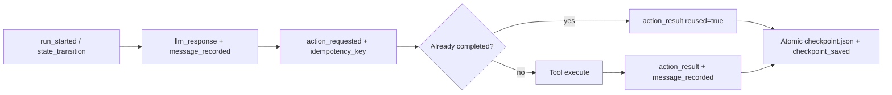

# ADR-006: Durable Execution Journal, Idempotency Keys, and Deterministic Replay

- **Status:** Accepted
- **Date:** 2026-11-23
- **Issue:** `#138` (M5: Durable execution — step-level checkpoints, resume, replay, idempotency)

## Context

Prior run persistence (`checkpoint.py` and `persistence.py`) wrote `run.json`, `messages.jsonl`, and `checkpoint.json` only after a full tool batch finished. A `SIGKILL` or host crash mid-batch left no record of completed tool calls before checkpoint time, risking duplicate side effects on resume, lost message deltas, and no standalone way to deterministically replay state transitions.

## Decision

Introduce an append-only, `fsync`-backed step journal (`journal.jsonl`, schema `run-journal-v1`) in `agent_forge/agent/journal.py` as the source of truth for step execution, crash reconciliation, and replay:

1. **Before-and-after step journaling:** `react_loop` appends `llm_response`, `message_recorded`, `action_requested`, `action_result`, `checkpoint_saved`, `verification_recorded`, and `state_transition` entries to `RunJournal` (`fsync=True` by default) before advancing the loop, alongside per-tool checkpoints.
2. **Idempotency keys:** Each tool step computes `compute_tool_idempotency_key(run_id, iteration, tool_call_id, tool_name, arguments, call_index)`. Built-in `Tool` classes declare `side_effecting` (`False` for read-only inspection tools, `True` by default for mutating/shell/git tools). On resume or crash recovery (`reconcile_run_from_journal`), already-completed actions reuse their recorded `ToolResult` (`reused=True`) without re-executing.
3. **Crash tolerance:** `load_journal_entries` tolerates and atomically repairs a single torn final JSONL line produced by a mid-write crash while rejecting middle-file corruption. `persistence._atomic_write_bytes` flushes, `fsync`s, and atomically replaces snapshots (`run.json`, `messages.jsonl`, `events.jsonl`, `checkpoint.json`, `checkpoint.patch`).
4. **Recoverable interruption states:** `CancellationToken.interrupt(...)` requests a recoverable pause (`PAUSED`) without raising an exception. CLI `SIGINT`/`SIGTERM` handlers convert signals into recoverable interrupts with an explicit resume hint, while direct task cancellation (`CancelledError`) continues to preserve existing cancellation semantics.
5. **Deterministic replay & M0 trajectories:** `replay_journal()` reconstructs runs offline through the real `state.transition()` state machine, flagging invalid transitions, sequence gaps, incomplete actions, and duplicate side effects (`agent-forge replay <run-id|path>`). M0 benchmark runs (`agent_forge/eval/benchmark.py` and `deterministic.py`) capture trajectories in the same `run-journal-v1` schema.

## Consequences

- Every coding and benchmark run produces one inspectable, replayable JSONL artifact.
- Mid-batch crashes and `SIGKILL` resume without repeating previously committed side-effecting tool calls.
- Slight disk flush overhead per step (`fsync=True`); disabled cleanly (`fsync=False`) for synthesized batch exports.
