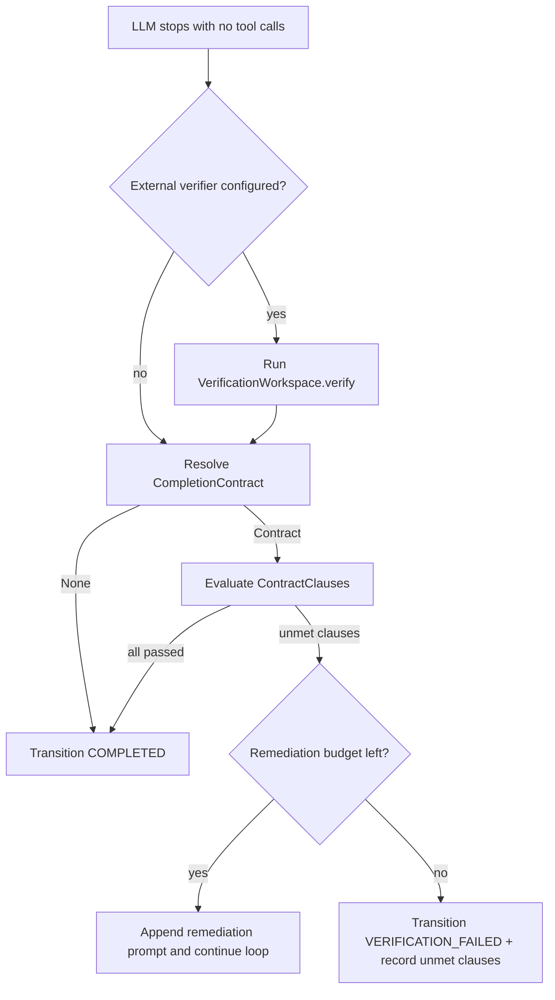

# ADR-007: Verification-Aware Completion Contracts

- **Status:** Accepted
- **Date:** 2026-11-23
- **Issue:** `#139` (M5: Verification-aware completion contract)

## Context

Previously, `react_loop` transitioned a run to `RunState.COMPLETED` whenever the model returned `finish_reason="stop"` without tool calls (or when no verifier rejected it). An agent that inspected one file and claimed completion finished identically to one that applied changes and passed tests. Meanwhile, the hosted service compensated with an imperative second-run `_REPORT_RECOVERY_PROMPT` loop in `agent_forge/service/app.py`.

## Decision

Introduce a composable, domain-agnostic `CompletionContract` mechanism in `agent_forge/agent/contracts.py`, enforced inside the ReAct loop before terminal state selection:

1. **First-class `RunState.VERIFICATION_FAILED`:** Unmet completion contracts transition the run to `RunState.VERIFICATION_FAILED` (distinct from generic `FAILED` execution errors), persisting `AgentRun.contract_evaluation` (`completion-contract-v1`) in `run.json` and `contract_evaluated` in `journal.jsonl`.
2. **Composable built-in clauses:** `ChangesExistClause`, `PatchAppliesCleanlyClause`, `ChecksExecutedClause`, `VerificationChecksPassedClause`, `NoUnacknowledgedFailuresClause`, and `JsonArtifactClause` evaluate harness-controlled state rather than model claims.
3. **Profile & extension resolution:** Profiles configure `completion_contract` in YAML (`qa`, `coding_fix`, `artifact_report`, `extension`), extensions register contracts via the `agent_forge.contracts` entry-point group (plus YAML `entrypoint` resolution), and `agent-forge run --contract [auto|qa|coding-fix]` allows per-task selection.
4. **Domain contract extraction:** Proof-of-Audit supplies its `.agent-forge/report.json` (`ProofOfAuditReport`) contract exclusively inside `plugins/proof_of_audit/contracts.py`, replacing the hosted service's imperative two-loop report-recovery pass with single-loop contract remediation (`max_remediation_attempts=1`) while keeping `agent_forge/*` free of domain vocabulary.

## Consequences

- Read-only / incomplete candidate stops on coding benchmarks are cleanly rejected as `VERIFICATION_FAILED` with structured `unmet_clauses` (`0%` false-positive completion rate).
- Q&A tasks can select `qa_contract()` without requiring code edits.
- Domain plugins define custom output/artifact completion rules declaratively without modifying core harness code.
