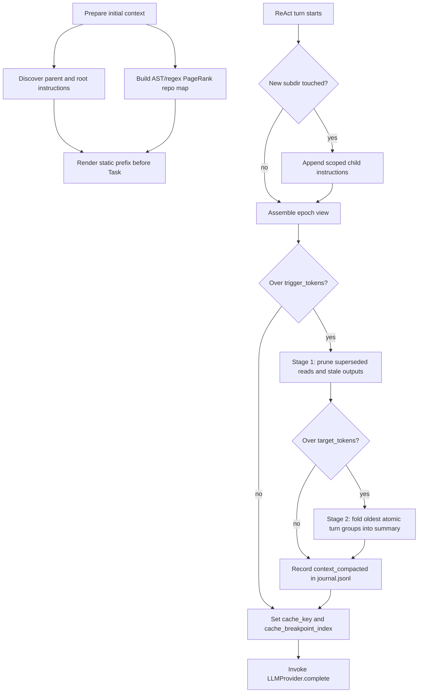

# ADR-008: M2 Context Engine

- **Status:** Accepted
- **Date:** 2026-11-23
- **Issue:** `#24` (M2: Context engine — layered repo instructions, repository map, working set, compaction)

## Context

Previously, `build_system_prompt` rendered tool definitions and the raw task string while `react_loop` passed the full unpruned `run.messages` list to every LLM call. Repository conventions (`AGENTS.md`, `CLAUDE.md`) were ignored unless pasted manually, large repositories lacked structural orientation, and repeated `read_file` or verbose shell outputs bloated token spend across multi-turn runs.

## Decision

Introduce a modular `ContextEngine` in `agent_forge/agent/` that assembles bounded, cache-aligned prompt views without mutating persisted `AgentRun.messages`:

1. **Hierarchical instruction discovery (`agent_forge/agent/instructions.py`):** Walks from the enclosing `.git` boundary down to the workspace root and target child directories, loading `AGENTS.md`, `CLAUDE.md`, and `.agent-forge/instructions.md`. Resolves symlinks (`CLAUDE.md -> AGENTS.md`) via `Path.resolve()` to deduplicate identical targets, enforces token budgets, and appends newly unlocked child-directory instructions mid-run via `pop_scoped_instruction_message`.
2. **Dependency-aware repository map (`agent_forge/agent/repo_map.py`):** Uses Python `ast` plus regex extractors for TypeScript/JavaScript, Go, Rust, Java, Ruby, and C/C++, then runs Personalized PageRank over import and symbol-reference edges while respecting `.gitignore` and `_IGNORED_DIRS`.
3. **Working set and epoch-based two-stage compaction (`agent_forge/agent/context.py`):** Tracks read/modified files in `WorkingSet` (pinning edited files, evicting oldest unpinned files, and tracking active failures and verification snapshots). Stage 1 replaces superseded `read_file` outputs and oversized stale tool outputs; Stage 2 folds complete atomic `(ASSISTANT, TOOL...)` turn groups into a structured `[CONTEXT SUMMARY ...]` preserving goal, working set, decisions, unresolved failures, and verification status.
4. **Prompt-cache alignment (`LLMConfig` & `prompts.py`):** Places static capabilities, rules, sandbox metadata, parent/root instructions, and the structural repository map before `## Task`, attaches `cache_key` and `cache_breakpoint_index` to `LLMConfig` for provider adapters (`#42`), and records `context_compacted` entries in `RunJournal` (`run.context_stats` in `run.json`).

## Consequences

- Multi-turn coding runs discover `AGENTS.md` / `CLAUDE.md` hierarchies automatically with zero user flags and cut cumulative prompt tokens without losing patch accuracy on the M0 corpus.
- Provider adapters (`#42`) receive deterministic `cache_key` and `cache_breakpoint_index` hints without changing `run.messages` persistence or replay semantics.
