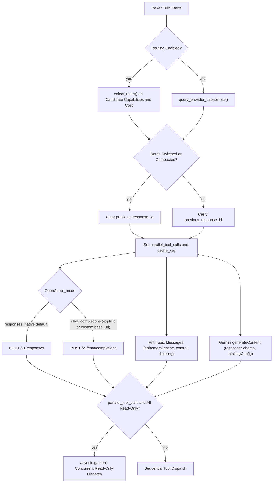

# ADR-009: M3 Provider API v2 — Capability Model, Responses Migration, and Routing

- **Status:** Accepted
- **Date:** 2026-11-23
- **Issue:** `#42` (M3: Provider API v2 — capability model, Responses migration, task/turn routing)

## Context

Prior provider adapters exposed lowest-common-denominator Chat Completions semantics: `OpenAIProvider` defaulted exclusively to stateless `/v1/chat/completions`, `LLMProvider` advertised no runtime capabilities to `react_loop`, prompt caching and reasoning continuity were unmodeled, and every turn stayed pinned to one model regardless of budget pressure or repeated tool failures.

## Decision

Introduce a runtime capability contract, migrate OpenAI's default transport to the Responses API with automatic fallback for custom endpoints, expose native Anthropic and Gemini v2 features, and add a data-driven turn router inside `agent_forge/llm/` and `agent_forge/agent/core.py`:

1. **Runtime capability model (`agent_forge/llm/capabilities.py`):** `ProviderCapabilities` declares boolean flags (`reasoning_continuity`, `parallel_tool_calls`, `prompt_caching`, `context_editing`, `structured_output`, `stateful_response_ids`, `native_tools`), `max_context_tokens`, and `api_protocol`. `LLMProvider.capabilities()` exposes these at runtime and `agent-forge models capabilities` prints JSON or table output for configured profiles.
2. **OpenAI Responses API default (`agent_forge/llm/openai.py`):** `OpenAIProvider` defaults to `api_mode="auto"`, resolving `"responses"` (`/v1/responses`) for native `https://api.openai.com*` endpoints and `"chat_completions"` (`/v1/chat/completions`) for custom OpenAI-compatible `base_url` proxies or explicit `api_mode="chat_completions"`. Responses requests support `instructions`, `input` item translation, delta slicing after matching `previous_response_id`, `prompt_cache_key`, `reasoning.effort`, `text.format` JSON schemas, SSE delta parsing, and `cached_tokens` / `reasoning_tokens` usage tracking.
3. **Anthropic, Gemini, and cost accounting (`anthropic.py`, `gemini.py`, `observability/cost.py`):** Anthropic adds ephemeral `cache_control` blocks when `cache_key` is set, `disable_parallel_tool_use`, `thinking` budgets, `thinking`/`redacted_thinking` block roundtrips, and `cache_read_input_tokens`. Gemini adds `responseMimeType`/`responseSchema`, `thinkingConfig`, `thought: True` reasoning blocks, and `cachedContentTokenCount`/`thoughtsTokenCount`. `_estimate_cost` discounts `cached_prompt_tokens` via `cache_read_input_token_cost` (or 50% of input price).
4. **Data-driven task/turn routing (`agent_forge/llm/router.py`, `agent_forge/config.py`):** `RoutingLLMProvider` and `select_route` rank candidates per turn under `cost_first`, `balanced`, or `capability_first` policies, applying `budget_downgrade` above `downgrade_budget_fraction` and `failure_escalation` after consecutive failures or remediation turns while deduplicating underlying HTTP clients across profiles sharing credentials and endpoint settings.
5. **ReAct loop capability adaptation (`agent_forge/agent/core.py`):** `react_loop` logs `route_selected` journal events, clears `previous_response_id` on context compaction or route switches, and uses `asyncio.gather` only when `capabilities().parallel_tool_calls` is true, approval mode is `"auto"`, and every pending call in the batch is read-only.

## Consequences

- Native OpenAI runs reduce continuation payload size and uncached token cost without breaking third-party OpenAI-compatible proxies or custom `base_url` configs.
- `RunJournal` (`route_selected`) and `messages.jsonl` (`response_id`, `reasoning_blocks`) preserve full replay and cross-turn reasoning continuity.
- All M3 unit (`tests/unit/test_provider_v2.py`, `tests/unit/test_llm_openai.py`, `tests/unit/test_model_qualification.py`), M0 Responses parity (`test_openai_responses_adapter_matches_or_beats_chat_completions_on_m0_corpus`), and boundary checks (`scripts/check_boundaries.py`, baseline `0`) pass without domain leakage into core packages.
