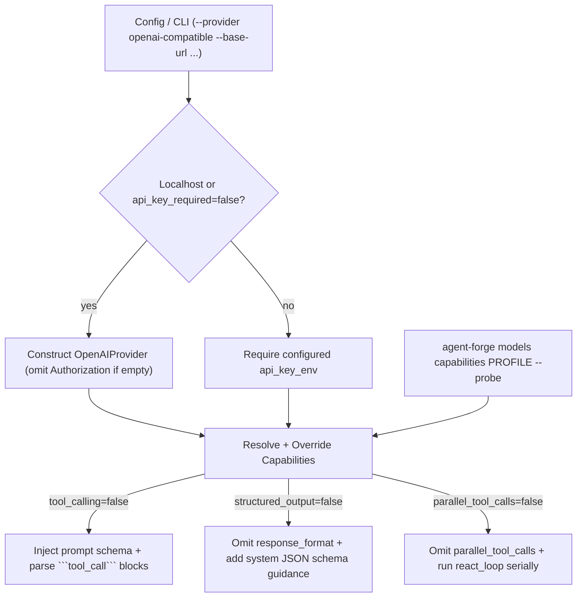

# ADR-010: Generic OpenAI-Compatible Endpoint Support

- **Status:** Accepted
- **Date:** 2026-11-23
- **Issue:** `#46` (M3: OpenAI-compatible endpoint support — Ollama, vLLM, llama.cpp, gateways)

## Context

Self-hosted inference servers (Ollama, vLLM, `llama.cpp` server, LM Studio) and hosted OpenAI-compatible gateways already speak `/v1/chat/completions`, yet running them in Agent Forge required `OPENAI_API_KEY` on local loopback URLs, lacked an explicit `openai-compatible` provider alias, failed with HTTP 400 when servers rejected `parallel_tool_calls` or `response_format`, and offered no live capability probing or fallback when native tool calling is absent.

## Decision

Support all OpenAI-compatible endpoints through the existing `OpenAIProvider` and the Provider API v2 capability contract ([ADR-009](009-provider-api-v2.md)) with zero vendor-specific code paths beyond capability declarations:



1. **Provider alias and local keyless auth (`factory.py`, `capabilities.py`, `config.py`, `qualification.py`):** Register `"openai-compatible": OpenAIProvider` defaulting to `api_mode="chat_completions"` and conservative capabilities (`tool_calling=True`, `structured_output=True`, `parallel_tool_calls=False`, `prompt_caching=False`, `stateful_response_ids=False`). Add `is_local_endpoint()` (`localhost`, `127.0.0.1`, `::1`, `0.0.0.0`, `host.docker.internal`, `*.localhost`) and optional `api_key_required` so loopback and `openai-compatible` runs without `api_key_env` skip API key checks across `cli.py`, `qualification.py`, `benchmark.py`, `router.py`, and `service/app.py`. Preserve built-in providers in `load_config()` and add `AGENT_FORGE_PROVIDERS_{PROVIDER}_{KEY}` env overrides.
2. **Graceful wire degradation (`agent_forge/llm/openai.py`):** Omit `Authorization` when `api_key` is blank, normalize `base_url`, add `list_models()` (`GET /models`), tolerate `"usage": null` and missing tool call IDs, capture `reasoning_content`/`reasoning`, and translate `httpx.ConnectError` to `LLMResponseError`. When capabilities disable `parallel_tool_calls`, omit the request field; when `structured_output=False`, omit `response_format` and append JSON schema instructions; when `tool_calling=False`, omit `tools`/`tool_choice` and use fenced ```` ```tool_call ... ``` ```` prompt emulation.
3. **Capability probing and CLI (`qualification.py`, `cli.py`, `runner.py`, `benchmark.py`):** Forward merged provider + profile `capabilities` overrides across every instantiation path, add `--base-url` on `agent-forge run`, and add `--probe` on `agent-forge models capabilities` via `probe_endpoint_capabilities()`.

## Consequences

- Running a local Ollama, vLLM, or `llama.cpp` server requires only TOML config or `--provider openai-compatible --base-url ... --model ...` with zero vendor-specific adapters or dummy API keys.
- Models served by endpoints lacking native parallel tool calls, JSON schemas, or tool calling still operate end-to-end inside `react_loop`.
