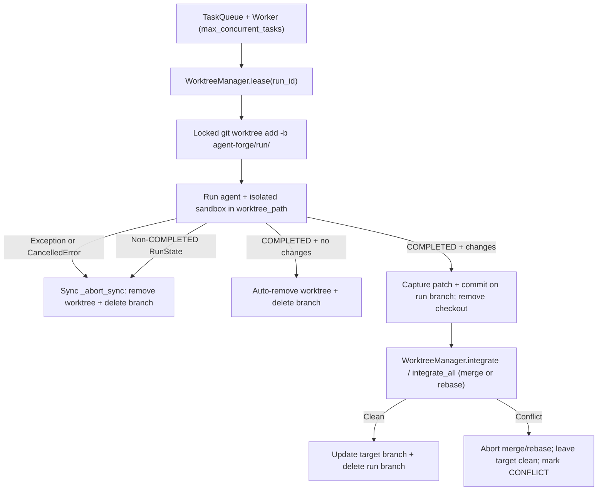

# ADR-011: Worktree-Isolated Parallel Agent Execution

- **Status:** Accepted
- **Date:** 2026-11-23
- **Issue:** `#33` (M6: Worktree-isolated parallel agent execution)

## Context

Running multiple queued agent tasks against the same repository previously executed sequentially (`Worker` processed one task at a time) against the shared mutable working tree. Parallel execution on a single working directory causes cross-contamination between task diffs, clobbered edits, and non-deterministic verification failures.

## Decision

Isolate every concurrent task execution inside its own dedicated Git worktree and branch via `WorktreeManager` (`agent_forge/orchestration/worktree.py`), deferring branch integration until merge time in the orchestrating layer:

1. **Per-run Git worktree & branch isolation (`agent_forge/orchestration/worktree.py`):** `WorktreeManager` serializes only short Git metadata operations per repository root using a thread lock while all agent turns and sandboxes execute concurrently in separate directories. Unchanged and non-completed runs remove both their worktree checkout and temporary branch automatically.
2. **Synchronous abort on cancellation:** `WorktreeManager.lease()` catches `BaseException` (including `asyncio.CancelledError`) and runs `_abort_sync()` synchronously under the repo lock so aborted or stopped runs never leave orphan worktrees or dangling branches. `cleanup_orphans()` provides idempotent recovery for any leftover state.
3. **Orchestration merge-time integration & worker concurrency (`worker.py`, `cli.py`, `config.py`, `eval/`):** `Worker` accepts `max_concurrent_tasks` and `worktree_isolation`, emits `worktree.created` and `worktree.cleaned` events, and overrides each isolated task's `repo_path` to its leased worktree. Merge-time integration (`integrate` / `integrate_all` and `agent-forge worktrees integrate`) supports `merge` and `rebase` strategies and relies on Git's native conflict machinery to abort cleanly when overlapping edits collide. `run_benchmark` and `run_deterministic_eval` support bounded `max_concurrency`.
4. **Explicit non-goal:** Live conflict resolution between concurrent agents modifying overlapping files is out of scope; integration returns `IntegrationResult(status="conflict", conflicted_files=[...])` without mutating the target branch.

## Consequences

- Concurrent runs on one shared repository produce isolated, independently verified patches with zero cross-contamination.
- Unchanged, failed, and cancelled parallel runs leave zero orphan worktrees or `agent-forge/run/*` branches.
- Conflicting branches remain intact for inspection via `git diff` or `agent-forge worktrees integrate` while keeping the primary branch clean.
