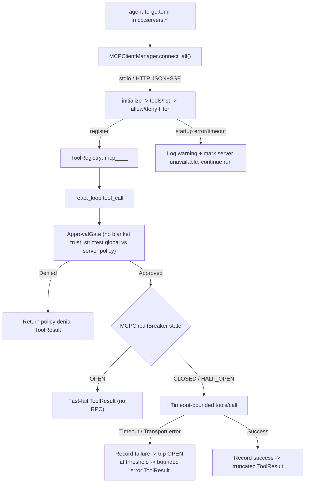

# ADR-012: External MCP Client Integration

- **Status:** Accepted
- **Date:** 2026-11-23
- **Issue:** `#40` (M6: MCP client — consume external MCP tool servers)

## Context

Agent Forge's core harness provides sandboxed workspace tools and entry-point plugins, but integrating ecosystem tool servers (filesystem, issue trackers, databases, code hosts) required custom Python wrapper packages. Model Context Protocol (MCP) standardizes tool schema discovery (`tools/list`) and invocation (`tools/call`) over stdio subprocesses and Streamable HTTP.

## Decision

Add a zero-new-dependency external MCP client in `agent_forge/tools/mcp.py` that bridges configured MCP servers directly into `ToolRegistry`, routes every call through `ApprovalGate` with no blanket trust, and isolates server failures with timeouts and circuit breaking:

1. **Transports and Schema Ingestion (`agent_forge/tools/mcp.py`, `config.py`):** Implement `StdioMCPTransport` (subprocess JSON-RPC 2.0 with minimal env + explicit `env_passthrough` / `${VAR}` expansion and clean process termination) and `HttpMCPTransport` (Streamable HTTP with `application/json`, `text/event-stream` SSE parsing, `MCP-Session-Id` propagation, and `auth_env` header injection). Normalize tool names as `mcp__<server>__<tool>` and filter via `allow_tools` / `deny_tools`.
2. **Policy-Gated Approval Integration (`approvals.py`, `core.py`):** Classify every MCP tool through `ApprovalGate` with no blanket trust (`side_effecting=True` by default, excluded from unapproved parallel batches). Servers can tighten policy via `approval_mode` (`inherit|auto|prompt|deny`) but never weaken global policy; read-only tools skip approval only when `readOnlyHint=true`, `destructiveHint` is not true, and `allow_read_only_without_approval=true` is explicitly configured.
3. **Failure Isolation:** Bound startup and invocation latency (`startup_timeout_seconds`, `timeout_seconds`), truncate oversized outputs (`max_output_chars`), and wrap every server with `MCPCircuitBreaker` (`closed -> open -> half_open`) so slow, crashing, or unreachable MCP servers degrade to structured error `ToolResult`s without wedging the run.

## Consequences

- External stdio and HTTP MCP servers plug directly into `agent-forge run`, `run_agent_task()`, and `agent-forge mcp list|inspect` with zero changes to `react_loop` control flow.
- Core tests and runs with no `[mcp.servers]` configured incur zero startup overhead and spawn zero subprocesses.
- Server exposure (`agent-forge` acting as an MCP server) stays deferred to a separate follow-up issue.
