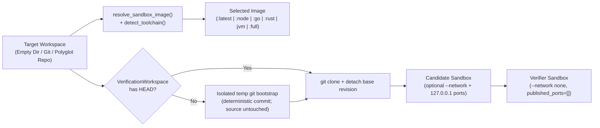

# ADR-015: Polyglot Sandbox Toolchains, Port Publishing, and Greenfield Verification

- **Status:** Accepted
- **Date:** 2026-11-24
- **Issue:** `#197` (M7: Polyglot sandbox toolchains, host port publishing, and greenfield project verification)

## Context

Agent Forge previously shipped only Python, Node, and Python+Node sandbox images, offered no automatic ecosystem detection, could not publish container loopback ports to preview running services, and failed inside `VerificationWorkspace` whenever the target workspace was an empty greenfield directory or an uninitialized checkout with zero Git commits.

## Decision

Extend the generic sandbox and verification layers without introducing language-specific logic into `agent_forge/agent/core.py`:

1. **Built-in polyglot images & `sandbox.toolchain` auto-detection (`agent_forge/sandbox/toolchain.py`):** Ship `Dockerfile.go`, `Dockerfile.rust`, and `Dockerfile.jvm` alongside Python/Node/Full variants. `detect_toolchain()` inspects top-level project markers (`go.mod`, `Cargo.toml`, `pom.xml`/`build.gradle*`, `package.json`, `pyproject.toml`) cleanly defaulting empty directories to `"python"`, while `resolve_sandbox_image()` always honors an explicit custom `--sandbox-image`.
2. **Loopback port publishing (`agent_forge/sandbox/base.py`, `docker.py`, `bwrap.py`):** Add `sandbox.published_ports` / `--publish-port` parsed through `parse_published_ports()`, binding host loopback (`127.0.0.1` by default) in `DockerSandbox`, rejecting port publishing when `--no-network` is active, and populating Go/Rust/Gradle cache paths when `/cache` is enabled.
3. **Greenfield `VerificationWorkspace` bootstrap (`agent_forge/agent/verification.py`):** When the target directory has no committed `HEAD` (empty folder, uninitialized seed directory, or `git init` with zero commits), copy seed files into an isolated temporary Git repository with a deterministic baseline commit (`1970-01-01T00:00:00Z`), leaving the user's source directory untouched. `VerificationWorkspace.verify()` strips `published_ports` and forces `network_enabled=False`.

## Consequences

- Agent Forge can scaffold, compile, test, and `--verify-command` greenfield projects across Python, Node/TypeScript, Go, Rust, and JVM without pre-existing Git history.
- Verifier runs stay strictly offline with zero port conflicts even when candidate runs preview services over loopback ports.
