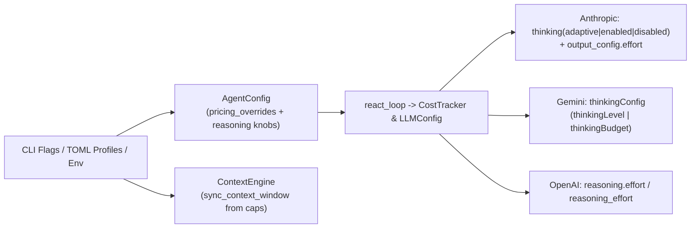

# ADR-016: Frontier Model Metadata Refresh, Per-Profile Pricing Overrides, and Reasoning Controls

- **Status:** Accepted
- **Date:** 2026-11-24
- **Issue:** `#198` (M7: Frontier model metadata refresh, per-profile pricing overrides, and adaptive reasoning knobs)

## Context

Newly released frontier models (for example `claude-opus-5-5`, `gpt-6.2-sol`, `gemini-4-neon`, and private endpoints) need accurate token pricing for `--max-cost` budgets, larger context windows in `ContextEngine`, and native reasoning controls (`thinking: {"type": "adaptive"}`, `output_config.effort`, and Gemini `thinkingLevel`) without code releases per model ID.

## Decision

1. **Vendored metadata & backward-compatible fallbacks (`scripts/update_prices.py`, `agent_forge/observability/cost.py`):** Refresh `agent_forge/observability/model_prices.json`, preserve optional `cache_read_input_token_cost` and `max_input_tokens` fields, seed `_FALLBACK_PRICES` underneath the loaded snapshot so deprecated defaults remain resolvable, and look up provider-prefixed LiteLLM keys (`gemini/<model>`, `anthropic/<model>`, `openai/<model>`) alongside exact matches.
2. **Per-profile pricing overrides (`ModelProfileSettings`, `AgentSettings`, `CostTracker`, `RoutingLLMProvider`, `benchmark.py`):** Accept `input_cost_per_million`, `output_cost_per_million`, and `cache_read_cost_per_million` in TOML profiles and agent config, resolving overrides before `COST_TABLE` so `--max-cost` caps apply immediately to unlisted model IDs.
3. **Generalized long-context sizing (`agent_forge/llm/capabilities.py`, `agent_forge/agent/context.py`, `runner.py`, `core.py`):** Replace fixed prefix lists with regex + vendored `max_input_tokens` lookup (`200k` / `1M` patterns) and auto-size `ContextEngine`'s window from resolved `ProviderCapabilities.max_context_tokens` when `context.auto_size_context_window = true` and `context_window_tokens` stays at the default (`100_000`).
4. **Native reasoning knobs (`LLMConfig`, `AnthropicProvider`, `GeminiProvider`, `OpenAIProvider`, `cli.py`):** Expose `thinking_mode`, `thinking_level`, `thinking_budget_tokens`, and `reasoning_effort` across TOML profiles, `AgentConfig`, and `agent-forge run` flags:

## Consequences

- Unlisted frontier models enforce `--max-cost` and route accurately using TOML `input_cost_per_million` / `output_cost_per_million`.
- Context compaction scales automatically to 200k–1M windows unless explicitly pinned, and native reasoning knobs pass through cleanly per provider.
