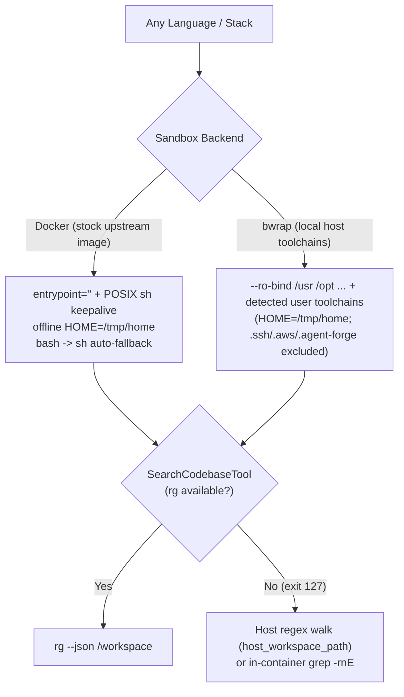

# ADR-017: Zero-Wrapper Stock Images and Host-Toolchain Bubblewrap Passthrough

- **Status:** Accepted
- **Date:** 2026-11-24
- **Issue:** `#202` (M8: Zero-wrapper stock Docker images and bwrap host-toolchain passthrough)

## Context

Supporting arbitrary languages across C#, C/C++, PHP, JS/TS, Solidity/Foundry, Bash, Go, Rust, Perl, Lisp, Haskell, and domain CLIs does not scale through custom wrapper Dockerfiles alone. Previously, stock upstream images failed in Agent Forge when they declared custom container `ENTRYPOINT`s, lacked `bash` or `rg` (`ripgrep`), or attempted to write toolchain state under `$HOME` in offline `--network none` read-only mode. Meanwhile, `BwrapSandbox` exposed only `/usr`/`/opt`/`/bin` and hid user-installed local toolchains (`~/.cargo`, `~/.pyenv`, `~/.nvm`, `~/.dotnet`, `~/.ghcup`, `~/.foundry`, `~/.local/share/mise`).

## Decision

Remove wrapper-image assumptions across Docker, search, and bubblewrap so stock images and local host toolchains work directly:

1. **Zero-wrapper Docker execution (`agent_forge/sandbox/docker.py`):** Override `entrypoint=""` with POSIX `["sh", "-c", "while :; do sleep 3600; done"]`, set `HOME=/tmp/home` and `XDG_CACHE_HOME=/tmp/xdg` in offline mode, and auto-fall back from `bash` to `sh` (sticky per container session) when `bash` is missing.
2. **Tool-agnostic codebase search (`agent_forge/tools/search_codebase.py`):** Keep `rg --json` primary, and when `rg` is missing (`exit_code == 127`), fall back to host-side Python regex search via `sandbox.host_workspace_path` or in-container POSIX `grep -rnE`.
3. **Read-only host toolchain passthrough (`agent_forge/sandbox/bwrap.py`, `base.py`, `config.py`, `runner.py`):** Mount detected user toolchain roots read-only (`sandbox.mount_host_toolchains = true`) and validate optional `sandbox.extra_ro_binds` through `validate_ro_bind_path()`, refusing `$HOME` itself and credential directories (`.ssh`, `.aws`, `.gnupg`, `.kube`, `.agent-forge`, `.config/gcloud`, `.docker/config.json`, `.netrc`, `.git-credentials`) while keeping `HOME` jailed to `/tmp/home` or `/cache/home`.

## Consequences

- Any upstream Docker image (e.g., `mcr.microsoft.com/dotnet/sdk:9.0`, `haskell:9.8`, `php:8.4-cli`, `ghcr.io/foundry-rs/foundry`, `alpine`, `gcc:14`) works immediately via `--sandbox-image` without bespoke Dockerfiles.
- Linux bubblewrap sessions inherit local host compilers and version managers read-only without exposing user credentials or permitting writes outside `/workspace` and `/tmp`.
