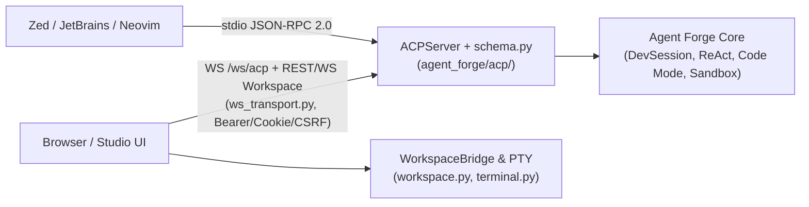

# ADR-030: Full ACP Spec Conformance, Authenticated Remote Transport & Registry Distribution

- **Status:** Accepted
- **Date:** 2026-11-26
- **Issues:** [#234](https://github.com/akoita/agent-forge/issues/234), [#235](https://github.com/akoita/agent-forge/issues/235), [#236](https://github.com/akoita/agent-forge/issues/236) (Milestone 14)
- **Deciders:** `@akoita`, Agent Forge maintainers

## Context

[ADR-013](013-acp-server-ide-interop.md) and [ADR-021](021-stateful-acp-sessions-and-replay.md) introduced `agent-forge acp` over `stdio` with durable `DevSession` replay. Supporting third-party IDEs (Zed, JetBrains, Neovim) and web/desktop clients reliably requires full [Agent Client Protocol (ACP)](https://agentclientprotocol.com/get-started/introduction) method coverage, typed frame validation, token streaming, structured diffs, a secure WebSocket + workspace transport for browsers, and a Registry `agent.json` manifest.

## Decision

1. **Strict Pydantic protocol schemas (`agent_forge/acp/schema.py`):** Define request, response, notification, and ACP Registry (`agent.json`) models plus `validate_acp_frame()` / `validate_registry_manifest()` for automated conformance testing.
2. **Complete ACP method & update surface (`protocol.py`, `server.py`):** Support `initialize` (`promptCapabilities.embeddedContext`, `mcpCapabilities`, `sessionCapabilities.list`, `authMethods`), `authenticate`, paginated `session/list`, runtime `session/set_config_option` / `session/set_mode`, `available_commands_update`, `plan`, live token streaming (`EventType.ASSISTANT_DELTA` without duplicate trailing chunks), structured `diff` + `locations` metadata from `edit_file`/`write_file`/`read_file`, and optional workspace-contained `fs/read_text_file` buffer negotiation.
3. **Authenticated WebSocket & workspace companion API (`ws_transport.py`, `workspace.py`, `terminal.py`):** Keep `fastapi` optional via lazy import behind `agent-forge[service]`, expose loopback-default `--transport ws` on `agent-forge acp`, enforce constant-time Bearer / `HttpOnly; SameSite=Strict` cookie + CSRF auth, reject URL query-param tokens, validate `Origin`, rate-limit traffic, contain file/Git access strictly within `workspace_root` (blocking traversal, symlinks escaping root, and `.git`), and confine PTY terminals to an allowlisted shell with credential env vars stripped.
4. **ACP Registry manifest & interop verification (`agent.json`, `docs/acp-ide-interop.md`):** Publish root `agent.json` with `uvx` distribution pinned to the package semver and verify subprocess + WebSocket E2E lifecycles in `tests/unit/test_acp_e2e_interop.py`.

## Consequences

- External editors and upcoming Agent Forge Studio Web/Desktop clients (Milestones 15–16) share one audited ACP protocol surface without bespoke adapters.
- `agent_forge/acp/` stays domain-agnostic and preserves zero required `fastapi` dependency in base installs.
