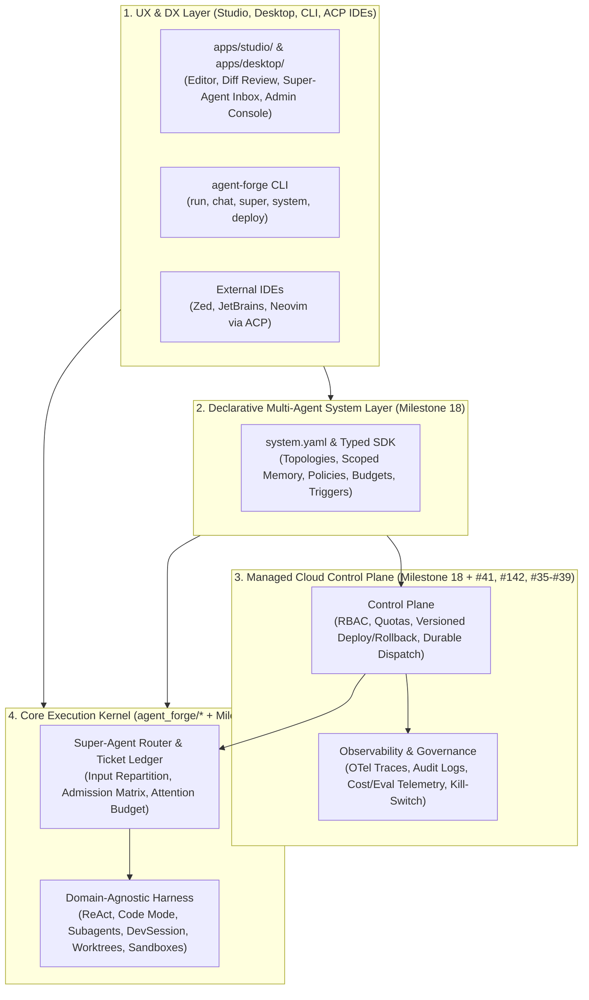

# ADR-031: Managed Multi-Agent Cloud Platform and Super-Agent Orchestrator

- **Status:** Accepted
- **Date:** 2026-11-27
- **Issues:** [#251](https://github.com/akoita/agent-forge/issues/251), [#255](https://github.com/akoita/agent-forge/issues/255) (Milestones 17–18) · Related: [#41](https://github.com/akoita/agent-forge/issues/41), [#142](https://github.com/akoita/agent-forge/issues/142), [#248](https://github.com/akoita/agent-forge/issues/248)–[#254](https://github.com/akoita/agent-forge/issues/254)
- **RFC:** [RFC-005](../rfcs/005-super-agent-project-orchestration.md)
- **Supersedes (scope only):** Single-agent and "no orchestration DSL / no broad platform" scope cap in [ADR-002](002-harness-first-reset.md) and [ADR-003](003-local-agent-and-hosted-pilot.md)

## Context

[ADR-002](002-harness-first-reset.md) paused hosted platform breadth until the core coding harness became measurable and domain-agnostic. Milestones 1–14 achieved that baseline: verification-aware completion ([ADR-007](007-verification-completion-contract.md)), worktree-isolated parallel runs ([ADR-011](011-worktree-isolated-parallel-execution.md)), bounded subagents ([ADR-026](026-hierarchical-subagent-delegation.md)), deterministic repo memory ([ADR-029](029-deterministic-repo-memory.md)), full ACP conformance with remote WebSocket transport ([ADR-030](030-full-acp-conformance-and-remote-transport.md)), and the initial Agent Forge Studio shell ([RFC-004](../rfcs/004-studio-web-and-electron-editor.md)).

With the core boundary mechanically enforced (`scripts/check_boundaries.py` at baseline `0`) and deterministic benchmarks in CI, Agent Forge can safely expand toward two coupled product needs:

1. **Coding Super-Agent (Milestone 17):** Project-level orchestration that repartitions incoming user requests into dependency-aware, worktree-isolated tickets with an explicit admission policy and human attention budget.
2. **Managed Multi-Agent Cloud Infrastructure (Milestone 18):** A high-level developer and operator experience (`system.yaml`/SDK, Studio UI, Admin Console) to specify, deploy, monitor, and administer single agents or complex production multi-agent systems.

## Decision

Expand Agent Forge's scope from a local harness + single-agent pilot into a four-layer **Managed Multi-Agent System Cloud Infrastructure and Coding Platform**, while preserving all harness-first quality and boundary invariants from [ADR-002](002-harness-first-reset.md).

1. **Supersede the scope cap, keep every quality gate:** Remove the moratorium on multi-agent specifications and managed cloud infrastructure in [ADR-002](002-harness-first-reset.md) and [ADR-003](003-local-agent-and-hosted-pilot.md). Retain mandatory verification contracts, deterministic eval gates (`make eval`), domain-agnostic core boundaries (`scripts/check_boundaries.py` at `0`), and standard MCP/ACP interop.
2. **Adopt Router–Worker Super-Agent orchestration ([RFC-005](../rfcs/005-super-agent-project-orchestration.md)):** Introduce project-input repartition, durable Ticket state, explicit admission rules, and attention-budgeted escalation on top of `WorktreeManager` and `ApprovalGate`.
3. **Adopt declarative multi-agent system definitions (`system.yaml` / SDK):** Support defining single-agent or multi-agent topologies declaratively with static validation (reachability, budgets, egress/secret policies) and local dry-run parity before cloud deployment.
4. **Deliver four production cloud guarantees:**
   - **Robust:** Immutable system revisions, canary promotion/rollback, durable queues/state across restarts, and verification-gated outputs.
   - **Secure:** Multi-tenant compute/network isolation, egress allowlists, host-brokered secrets, explicit approval gates, and RBAC.
   - **Monitored:** Distributed traces across agent hops, real-time event streams, cost/token attribution, and continuous eval metrics.
   - **Administrable:** Enforced quotas, immutable policy audit logs, and live pause, drain, and emergency kill-switch controls.

## Consequences

- **Positive:** Teams get one unified architecture scaling from local CLI/ACP coding runs and Studio Super-Agent sessions to production cloud multi-agent deployments without protocol forks or core domain leakage.
- **Accepted costs:** Higher surface area across `apps/studio/`, `agent_forge/orchestration/`, and `agent_forge/service/`; heavy cloud dependencies stay isolated behind optional `[service]` / `[cloud]` extras so base `agent-forge` installs remain lean.
- **Guardrail:** Any multi-agent or Super-Agent orchestration change must demonstrate measurable improvements or strict parity in deterministic eval suites against single-session baselines.
