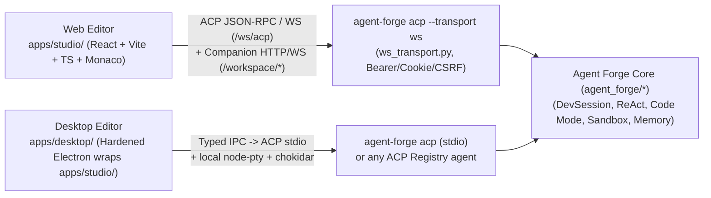

# RFC 004 — Agent Forge Studio (Web & Electron Code Editor)

**Status:** Accepted · 2026-11-27  
**Issues:** [#237](https://github.com/akoita/agent-forge/issues/237)–[#242](https://github.com/akoita/agent-forge/issues/242) · Related: [#28](https://github.com/akoita/agent-forge/issues/28), [#30](https://github.com/akoita/agent-forge/issues/30), [ADR-030](../adr/030-full-acp-conformance-and-remote-transport.md)

## Problem

Agent Forge now exposes a spec-complete [Agent Client Protocol (ACP)](https://agentclientprotocol.com/get-started/introduction) runtime over both `stdio` and an authenticated loopback-default WebSocket/HTTP companion bridge (`agent-forge acp --transport ws`). Developers need a clean browser and desktop code editor tailored to Agent Forge's diff review, approvals, terminal, and memory workflows without duplicating UI across Web, Electron, and the Milestone 6 hosted pilot.

## Proposal

Build **Agent Forge Studio** as two monorepo packages strictly outside Python core (`agent_forge/*`):

1. **Monorepo layout (`apps/studio/` + `apps/desktop/`):** Keep TypeScript frontend and Electron packages alongside the Python harness so protocol schemas (`agent_forge/acp/schema.py`), TypeScript ACP types, and CI checks move in lockstep without weakening `scripts/check_boundaries.py`.
2. **Lightweight React + Monaco + `xterm.js` shell:** Use `react`, `react-dom`, and locally bundled `monaco-editor` (Web Workers via Vite `?worker` imports, zero external CDN dependencies) instead of maintaining a heavy VS Code/Theia fork.
3. **Single standard ACP protocol:** Studio communicates exclusively via ACP JSON-RPC 2.0 plus the workspace companion routes (`WorkspaceBridge`), avoiding any bespoke agent protocol.
4. **Milestone 6 alignment (`#28`, `#30`):** Reuse `apps/studio/` workspace explorer, diff viewer, and ACP timeline components for the hosted pilot UI rather than maintaining a separate Next.js frontend.

## Alternatives and Trade-offs

| Option | Decision | Trade-off |
| --- | --- | --- |
| **Monorepo (`apps/`) vs separate repo** | Chosen: Monorepo (`apps/`) | Single PR/CI checks ACP contract + UI together; requires Node CI job alongside Python CI. |
| **Monaco Editor vs CodeMirror 6 vs OpenVSCode/Theia fork** | Chosen: React + Monaco Editor | First-class TypeScript/multi-language editing, native markers, and side-by-side `DiffEditor` without VS Code extension-host fork overhead; larger client bundle than CodeMirror 6. |
| **Cookie + CSRF auth vs `localStorage` Bearer token** | Chosen: `HttpOnly; SameSite=Strict` cookie + in-memory `X-CSRF-Token` | Prevents XSS token theft while working seamlessly across REST and WebSocket endpoints on the bridge. |

## Security Invariants

- **No browser storage secrets:** Exchange initial Bearer token via `POST /auth/session` with `credentials: "include"`, hold only the short-lived `csrfToken` in component/client memory, never write tokens to `localStorage`/`sessionStorage`, and never append tokens to URL query parameters.
- **XSS & DOM safety:** Rely on React framework escaping; prohibit `dangerouslySetInnerHTML`, `innerHTML`, and native `alert`/`confirm`/`prompt` modals.
- **Strict CSP & loopback binding:** Serve assets locally with `script-src 'self'`, `object-src 'none'`, and loopback `127.0.0.1:5173` dev binding.
- **Electron hardening (Milestone 16):** `contextIsolation: true`, `nodeIntegration: false`, typed preload IPC, and strict workspace containment.

## Verification Criteria

- **Issue #237:** `npm run typecheck`, `npm run test`, `npm run build`, `npm audit --audit-level=high`, CI `Studio` job green, and `python scripts/check_boundaries.py` green (`baseline size 0`).
- **Issues #238–#239:** Typed WebSocket ACP client, streaming tool/approval cards, Monaco DiffEditor, `xterm.js`, and Playwright E2E smoke tests in CI.
