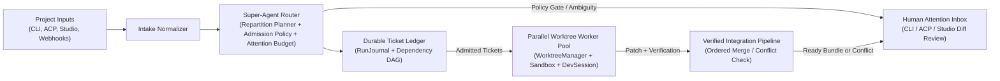
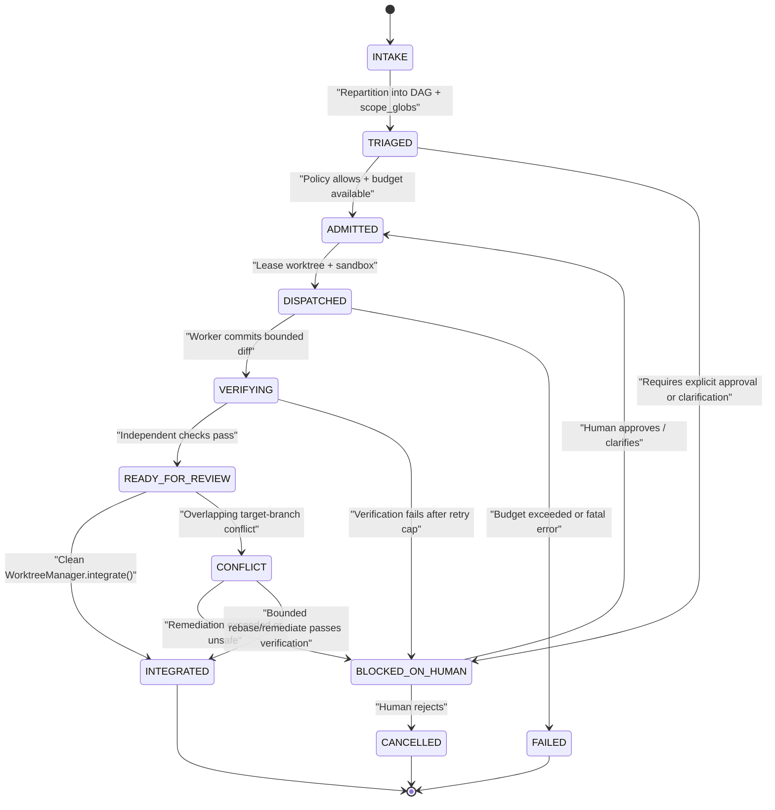

# RFC 005 — Super-Agent Project Orchestration (Router–Worker & Input Repartition)

**Status:** Accepted (Phase 1 #248 & Phase 2 #249 landed) · 2026-11-27  
**Issues:** [#251](https://github.com/akoita/agent-forge/issues/251) (Epic), [#248](https://github.com/akoita/agent-forge/issues/248)–[#250](https://github.com/akoita/agent-forge/issues/250) (Milestone 17) · Related: [ADR-011](../adr/011-worktree-isolated-parallel-execution.md), [ADR-019](../adr/019-declarative-tool-approvals-and-egress-proxy.md), [ADR-026](../adr/026-hierarchical-subagent-delegation.md), [ADR-030](../adr/030-full-acp-conformance-and-remote-transport.md), [ADR-031](../adr/031-multi-agent-cloud-platform-and-super-agent.md)

## Problem

Single-session coding runs stall on broad or multi-part project requests because one context window mixes discovery, edits across unrelated modules, and verification output. Synchronous `spawn_subagent` ([ADR-026](../adr/026-hierarchical-subagent-delegation.md)) solves turn-local exploration and isolated helper edits, and `WorktreeManager` ([ADR-011](../adr/011-worktree-isolated-parallel-execution.md)) isolates pre-queued tasks, yet developers still manually split inputs, sequence overlapping files, and babysit 3–5 concurrent sessions.

As highlighted in DeepSeek's Super-Agent design (*Exploring Super-agent Design: Towards a More Autonomous Agent System*, [reference post](https://x.com/DeepSeekHarness/status/2116857257245987236), [`dsh-superagent-prototype`](https://github.com/deepseek-ai/dsh-superagent-prototype)), human attention — not raw model capability — is the primary bottleneck. Agent Forge needs a project-level **Super-Agent** that repartitions incoming user requests into bounded, authorized, verified work packages and escalates only high-signal decisions.

## Proposal

Introduce a domain-agnostic **Router–Worker Super-Agent** engine (`agent_forge/orchestration/super_agent.py` and `agent_forge/orchestration/super_agent_dispatcher.py`) layered cleanly over Agent Forge's existing worktree, sandbox, session, journal, and approval primitives.

### Ticket State Machine

## Core Design Components

1. **Ticket Schema & Durable Ledger ([#248](https://github.com/akoita/agent-forge/issues/248)):** Store typed Pydantic `Ticket` records (`ticket_id`, `parent_input_id`, `goal`, `depends_on`, `scope_globs`, `risk_level`, `budget`, `branch`, `verification_summary`, `state`) inside a durable journal backed by `RunJournal` so restarts never duplicate work or lose state.
2. **Repartition & Scope-Overlap Planner ([#248](https://github.com/akoita/agent-forge/issues/248)):** Read repository structure and `.agent-forge/memory.md` (`ADR-029`) to split multi-part user prompts into a minimal DAG of independent tickets. Automatically synthesize a `depends_on` edge whenever two tickets estimate overlapping `scope_globs`, preventing parallel write collisions before dispatch.
3. **Explicit Admission & Authorization Matrix ([#248](https://github.com/akoita/agent-forge/issues/248)):**
   - **Auto-admit:** Bounded edits/tests inside allowed repository scopes with no unsatisfied dependencies and intact budgets.
   - **Serialize:** Tickets touching shared files or shared build artifacts run sequentially behind their dependency.
   - **Pause (`BLOCKED_ON_HUMAN`):** Ambiguous destructive actions, external side effects (`git push`, cloud mutations, schema drops), or budget extensions route through `ApprovalGate` ([ADR-019](../adr/019-declarative-tool-approvals-and-egress-proxy.md)).
4. **Attention Budget & Escalation Inbox ([#248](https://github.com/akoita/agent-forge/issues/248), [#250](https://github.com/akoita/agent-forge/issues/250)):** Cap concurrent human-facing questions and batch ready-for-review patches, diffs, and verification logs into structured review bundles rather than streaming noisy raw worker logs.
5. **Parallel Worker Dispatch & Verified Integration ([#249](https://github.com/akoita/agent-forge/issues/249)):** Each admitted ticket leases an isolated `WorktreeManager` checkout and `--network none` sandbox, executes via `DevSession` / `SubagentRunner`, passes an independent verification run (`VERIFYING`), and merges onto the target branch in dependency order. `CONFLICT` results abort cleanly without mutating the target branch and attempt at most one bounded remediation before escalating.
6. **Multi-Surface UX & Two-Plane Protocol Boundary ([#250](https://github.com/akoita/agent-forge/issues/250)):** Expose via `agent-forge super run|status|inbox|approve|integrate`, Typed REST + SSE/Event WS APIs for Super-Agent Ticket DAG/Inbox state and bulk review bundles (`apps/studio/`), and standard ACP (`ADR-030`) when inspecting or prompting an individual worker session. Coalesce streaming text deltas in UI state and load large diffs by reference rather than overloading ACP `_meta` payloads.

## Alternatives and Trade-offs

| Option | Decision | Trade-off |
| --- | --- | --- |
| **Router–Worker Super-Agent + Ticket Ledger** | Chosen | Clear ownership, overlap serialization before dispatch, crash-resumable state, and bounded human attention; adds orchestration state model. |
| **Unbounded nested `spawn_subagent` loops** | Rejected | Context and token budgets balloon quickly; subagents share a single parent turn without cross-input DAG persistence or Inbox batching. |
| **Free-form multi-agent chat swarm** | Rejected | High token overhead, unclear merge accountability, and hard-to-reproduce failure modes. |

## Security & Core Boundary Invariants

- **Domain-agnostic core:** `agent_forge/orchestration/super_agent.py` uses generic ticket, policy, and resource concepts and must keep `scripts/check_boundaries.py` at `baseline size 0`.
- **Fail-closed admission:** Unknown external actions or boundary-escaping path globs never auto-admit.
- **No secrets in sandboxes:** Workers run inside `--network none` sandboxes with host-brokered credentials only (`ADR-014`).
- **Guaranteed cleanup:** Worker cancellation or `CONFLICT` removes temporary worktrees and sandboxes cleanly with zero orphan state.

## Verification & Eval Criteria

- **Unit & crash-recovery suite ([#248](https://github.com/akoita/agent-forge/issues/248)–[#249](https://github.com/akoita/agent-forge/issues/249)):** Verify DAG repartition, overlap edge insertion, admission matrix decisions, attention budget coalescing, parallel worktree execution, conflict abort, and restart recovery.
- **Deterministic multi-ticket eval benchmark ([#250](https://github.com/akoita/agent-forge/issues/250)):** Compare Super-Agent orchestration vs a single-session harness baseline on multi-component tasks across verified-fix completion rate, merge-conflict rate, human-interruption count, and token/cost overhead.
