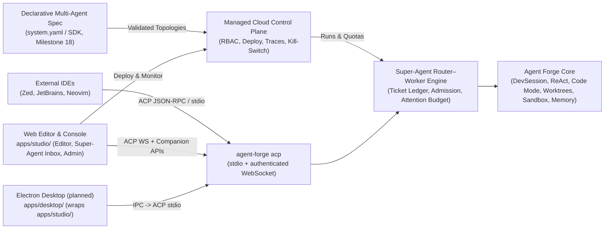

# Agent Forge roadmap

Agent Forge delivers a verified coding harness, scales project execution through a Router–Worker **Super-Agent**, and exposes single and complex multi-agent topologies through a **managed multi-agent cloud infrastructure** and **Agent Forge Studio**. The [vision](vision.md) describes the user outcomes, and the [strategy](strategy.md) defines how progress is measured.

[ADR-002](adr/002-harness-first-reset.md) established independent evaluation and a domain-agnostic core. [Proposed ADR-003](adr/003-local-agent-and-hosted-pilot.md) staged the local and hosted pilot path. [ADR-031](adr/031-multi-agent-cloud-platform-and-super-agent.md) evolves the platform scope to include managed multi-agent cloud infrastructure and Super-Agent orchestration while retaining every quality and boundary gate.

## Delivery milestones

| Milestone | User outcome |
| --- | --- |
| [1. Establish the verified-fix baseline](https://github.com/akoita/agent-forge/milestone/1) | Developers can distinguish a correct patch from an empty or incorrect change. |
| [2. Ship a verified local fix](https://github.com/akoita/agent-forge/milestone/2) | A developer can run the CLI on a committed revision, inspect the verified patch, and retain existing local edits. |
| [3. Use the agent on everyday work](https://github.com/akoita/agent-forge/milestone/3) | A developer can control spend, interrupt work, and continue from a known state. |
| [4. Measure and choose a model default](https://github.com/akoita/agent-forge/milestone/4) | A maintainer can qualify model candidates and choose the default using measured results. |
| [5. Operate the coding agent on GCP](https://github.com/akoita/agent-forge/milestone/5) | An operator can submit work remotely and retrieve a verified result across a restart. |
| [6. Run an invite-only SaaS pilot](https://github.com/akoita/agent-forge/milestone/6) | Two invited developers can submit and retrieve their own runs under enforced quotas and isolation. |
| [7. End-to-End Engineering Readiness](https://github.com/akoita/agent-forge/milestone/7) | Local models (`openai-compatible`), host auth/`git_push`, polyglot toolchains, and greenfield verification work end-to-end. |
| [8. Universal Polyglot Runtime & Safe Deployments](https://github.com/akoita/agent-forge/milestone/8) | Stock Docker images, `.devcontainer.json`/`mise`, two-phase `setup_command`, declarative approval hooks, and host egress proxy. |
| [9. Agentic Development Environment (ADE) Sessions](https://github.com/akoita/agent-forge/milestone/9) | Durable `DevSession` snapshots, stateful `ACP` replay, and interactive `agent-forge chat`/`session` CLI with warm sandboxes. |
| [10. Daily-Driver ADE UX & v0.7.0 Release](https://github.com/akoita/agent-forge/milestone/10) | OpenRouter gateway, live streaming & prompt history, `/diff`/`/undo`/`/sessions`/`/resume`, warm Docker integration tests, and `v0.7.0`. |
| [11. SOTA Agent Loop: Subagents & Code Mode](https://github.com/akoita/agent-forge/milestone/11) | Bounded hierarchical subagent delegation ([#32](https://github.com/akoita/agent-forge/issues/32)) and benchmarked Code Mode execution ([#193](https://github.com/akoita/agent-forge/issues/193)). |
| [12. SOTA Harness Hardening, Real-Sandbox Verification & v0.8.0](https://github.com/akoita/agent-forge/milestone/12) | Real Docker integration + chat/ACP UX ([#223](https://github.com/akoita/agent-forge/issues/223)), polyglot tree-sitter symbol/diagnostics loop ([#224](https://github.com/akoita/agent-forge/issues/224)), and `v0.8.0` paired baseline ([#225](https://github.com/akoita/agent-forge/issues/225)). |
| [13. Extension Packs, Safe Cloud/On-Chain Deployments & Repo Memory](https://github.com/akoita/agent-forge/milestone/13) | Domain-isolated GCP/AWS/Terraform ([#226](https://github.com/akoita/agent-forge/issues/226)) and EVM/Foundry ([#227](https://github.com/akoita/agent-forge/issues/227)) plugin packs plus deterministic `.agent-forge/memory.md` ([#25](https://github.com/akoita/agent-forge/issues/25)). |
| [14. Full ACP Compliance, Remote Transport & Registry Distribution](https://github.com/akoita/agent-forge/milestone/14) | Full [ACP](https://agentclientprotocol.com/get-started/introduction) conformance + schema tests ([#234](https://github.com/akoita/agent-forge/issues/234)), authenticated WebSocket/HTTP transport + workspace bridge ([#235](https://github.com/akoita/agent-forge/issues/235)), and ACP Registry `agent.json` + [IDE interop guide](acp-ide-interop.md) + [ADR-030](adr/030-full-acp-conformance-and-remote-transport.md) ([#236](https://github.com/akoita/agent-forge/issues/236)). |
| [15. Agent Forge Studio: Web Code Editor](https://github.com/akoita/agent-forge/milestone/15) | Delivered [RFC-004](rfcs/004-studio-web-and-electron-editor.md) React/Monaco web editor (`#237`), ACP WebSocket streaming + approvals (`#238`), and Monaco DiffEditor + `xterm.js` terminal + Memory panel + `agent-forge studio` launcher + Playwright E2E (`#239`). |
| [16. Agent Forge Studio: Electron Desktop App & Packaging](https://github.com/akoita/agent-forge/milestone/16) | *Planned:* hardened Electron shell under `apps/desktop/` wrapping `apps/studio/` ([#240](https://github.com/akoita/agent-forge/issues/240)), direct `stdio` ACP hosting + `node-pty` + multi-agent Registry launch ([#241](https://github.com/akoita/agent-forge/issues/241)), and cross-platform CI packaging ([#242](https://github.com/akoita/agent-forge/issues/242)). |
| [17. Super-Agent Coding Orchestrator (Router–Worker & Input Repartition)](https://github.com/akoita/agent-forge/milestone/17) | *Planned ([RFC-005](rfcs/005-super-agent-project-orchestration.md), Epic [#251](https://github.com/akoita/agent-forge/issues/251)):* Ticket ledger + intake repartition + admission matrix + attention budget ([#248](https://github.com/akoita/agent-forge/issues/248)), parallel worktree worker dispatcher + conflict remediation ([#249](https://github.com/akoita/agent-forge/issues/249)), and CLI/ACP/Studio Inbox UX + multi-ticket eval suite ([#250](https://github.com/akoita/agent-forge/issues/250)). |
| [18. Managed Multi-Agent System Cloud Infrastructure & Declarative DX](https://github.com/akoita/agent-forge/milestone/18) | *Planned ([ADR-031](adr/031-multi-agent-cloud-platform-and-super-agent.md), Epic [#255](https://github.com/akoita/agent-forge/issues/255)):* declarative `system.yaml`/SDK spec + topology validator + dry-run ([#252](https://github.com/akoita/agent-forge/issues/252)), versioned multi-tenant control plane ([#253](https://github.com/akoita/agent-forge/issues/253) with [#41](https://github.com/akoita/agent-forge/issues/41), [#142](https://github.com/akoita/agent-forge/issues/142), [#35](https://github.com/akoita/agent-forge/issues/35)–[#38](https://github.com/akoita/agent-forge/issues/38)), and observability/audit/kill-switch Admin Console ([#254](https://github.com/akoita/agent-forge/issues/254) with [#39](https://github.com/akoita/agent-forge/issues/39), [#28](https://github.com/akoita/agent-forge/issues/28), [#30](https://github.com/akoita/agent-forge/issues/30)). |

The [delivery plan](delivery-plan.md) records prerequisites, issue order, and exit criteria. GitHub tracks current assignments. Use the documented criteria and observed evidence to close a milestone.

## Product and engineering boundaries

- The core owns the agent loop, tools, configuration, policies, context, events, sandbox interface, and runner contract. Keep it portable and enforce the extension boundary with `scripts/check_boundaries.py`.
- Extensions own domain profiles, prompts, tools, and schemas. Deliver cloud/blockchain workflows via extension packs (`plugins/cloud-deploy/`, `plugins/evm-foundry/`).
- The hosted application and control plane own identity, tenancy, system versioning, quotas, queues, artifacts, observability, audit logs, and kill-switch governance. Release work spans [#142](https://github.com/akoita/agent-forge/issues/142), [#253](https://github.com/akoita/agent-forge/issues/253), and [#254](https://github.com/akoita/agent-forge/issues/254), sharing `apps/studio/` UI primitives.
- Studio packages (`apps/studio/` and `apps/desktop/`) live outside `agent_forge/*` in the monorepo, use standard ACP JSON-RPC for coding sessions, and ship as a lightweight React + Monaco + `xterm.js` shell rather than a VS Code/Theia fork.
- Measure the effect of harness, Super-Agent, and multi-agent system changes on task success, cost, latency, human interruptions, and tool failures.

## Later work

Milestones 11–14 (`v0.8.0` SOTA harness, extension packs, `.agent-forge/memory.md`, and full ACP conformance + WebSocket/Registry distribution in [#234](https://github.com/akoita/agent-forge/issues/234)–[#236](https://github.com/akoita/agent-forge/issues/236)) have landed. Planned engineering tracks cover:

- **Agent Forge Studio (Web & Electron):** Milestones 15–16 ([#237](https://github.com/akoita/agent-forge/issues/237)–[#242](https://github.com/akoita/agent-forge/issues/242)) alongside Milestone 6 ([#142](https://github.com/akoita/agent-forge/issues/142)).
- **Coding Super-Agent Orchestrator:** Milestone 17 ([#251](https://github.com/akoita/agent-forge/issues/251): [#248](https://github.com/akoita/agent-forge/issues/248)–[#250](https://github.com/akoita/agent-forge/issues/250)).
- **Managed Multi-Agent Cloud Infrastructure:** Milestone 18 ([#255](https://github.com/akoita/agent-forge/issues/255): [#252](https://github.com/akoita/agent-forge/issues/252)–[#254](https://github.com/akoita/agent-forge/issues/254)).

The planned interfaces are the CLI, declarative `system.yaml`/SDK, ACP, Agent Forge Studio (Web, Electron desktop, Inbox, and Admin Console), and the managed cloud APIs. Custom non-ACP/non-MCP wire protocols, vector memory by default, bespoke per-IDE plugins, and an open third-party tool marketplace remain out of scope.
