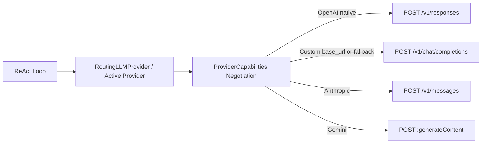
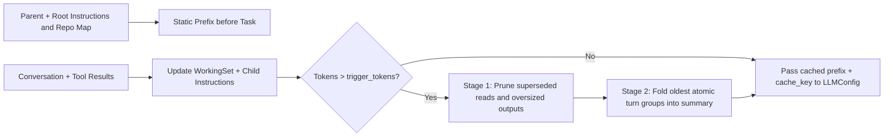

# Agent Forge — Technical Specification

> **Status:** Draft v1.0  
> **Last updated:** 2026-03-07

---

## Table of Contents

1. [Executive Summary](#1-executive-summary)
2. [Goals & Vision](#2-goals--vision)
3. [System Architecture](#3-system-architecture)
4. [Module Specifications](#4-module-specifications)
   - 4.1 [LLM Client Layer](#41-llm-client-layer)
   - 4.2 [Tool System](#42-tool-system)
   - 4.3 [Sandbox Runtime](#43-sandbox-runtime)
   - 4.4 [Agent Core (ReAct Loop)](#44-agent-core-react-loop)
   - 4.5 [Orchestration Layer](#45-orchestration-layer)
   - 4.6 [Observability](#46-observability)
5. [Data Models & Schemas](#5-data-models--schemas)
6. [Configuration](#6-configuration)
7. [Error Handling & Reliability](#7-error-handling--reliability)
8. [Security Model](#8-security-model)
9. [Testing Strategy](#9-testing-strategy)
10. [Project Structure](#10-project-structure)
11. [Deployment & Infrastructure](#11-deployment--infrastructure)
12. [Roadmap](#12-roadmap)

---

## 1. Executive Summary

**Agent Forge** is a sandboxed AI coding agent runtime that autonomously modifies codebases by orchestrating LLM reasoning with isolated tool execution. It implements the **ReAct** (Reasoning + Acting) pattern: an agent receives a coding task, iteratively reasons about what to do, invokes tools inside Docker containers, and loops until the task is complete.

### Key differentiators

| Differentiator               | What it means                                                                   |
| ---------------------------- | ------------------------------------------------------------------------------- |
| **Sandboxed execution**      | Every tool invocation runs in an ephemeral Docker container — never on the host |
| **Multi-provider LLM**       | Gemini (primary), OpenAI, Anthropic via a unified adapter layer                 |
| **Production observability** | Structured logs, trace IDs, token/cost tracking on every run                    |
| **Queue-based scaling**      | Redis + task queue for concurrent, isolated agent runs                          |

---

## 2. Goals & Vision

### Core Goals

- Provide a **working end-to-end agent** that can autonomously modify code in a sandboxed repository.
- Implement **production-grade patterns**: retries, timeouts, structured logging, cost tracking.
- Support **multiple LLM providers** behind a clean abstraction.
- Run all tools **inside isolated Docker containers** to prevent host contamination.
- Be **easily extensible** — adding a new tool or LLM provider should require only implementing an interface.
- Provide clear **documentation and demo recordings** to showcase the system's capabilities.

### Long-Term Vision

Agent Forge is designed to evolve from a single-agent CLI tool into a **full-stack AI coding agent platform**. Every layer is architected with this trajectory in mind:

| Dimension          | Starting Point              | Evolution Path                                                    |
| ------------------ | --------------------------- | ----------------------------------------------------------------- |
| **Interface**      | CLI-first                   | → REST API → Real-time Web Dashboard → IDE plugins                |
| **Isolation**      | Docker containers           | → Firecracker microVMs → Kubernetes pod sandboxes                 |
| **Agent topology** | Single agent, single task   | → Multi-agent collaboration → hierarchical delegation             |
| **LLM strategy**   | Foundation model APIs as-is | → Custom system prompts → fine-tuned routing → self-hosted models |
| **Multi-tenancy**  | Single-user local           | → Auth + RBAC → team workspaces → SaaS billing                    |
| **Tool ecosystem** | Built-in tools only         | → Plugin system → MCP server → community marketplace              |
| **Memory**         | Stateless per-run           | → Persistent memory → cross-run learning → vector-backed RAG      |

Each step on these paths is captured as a concrete milestone in [§12. Roadmap](#12-roadmap).

---

## 3. System Architecture

### 3.1 High-Level Diagram

```
┌───────────────────────────────────────────────────────────────────┐
│                          CLI / API                                │
│                   (click CLI + optional REST)                     │
└────────────────────────────┬──────────────────────────────────────┘
                             │
                             ▼
┌───────────────────────────────────────────────────────────────────┐
│                     Orchestration Layer                            │
│  ┌─────────────┐  ┌──────────────┐  ┌─────────────────────────┐  │
│  │ Task Queue   │  │ State Machine│  │ Event Bus               │  │
│  │ (Redis/      │  │ (per-run     │  │ (in-process pub/sub     │  │
│  │  in-memory)  │  │  lifecycle)  │  │  + optional WebSocket)  │  │
│  └──────┬───────┘  └──────┬───────┘  └────────────┬────────────┘  │
└─────────┼─────────────────┼───────────────────────┼───────────────┘
          │                 │                       │
          ▼                 ▼                       ▼
┌───────────────────────────────────────────────────────────────────┐
│                        Agent Core                                 │
│  ┌──────────────────────────────────────────────────────────────┐ │
│  │                    ReAct Loop                                │ │
│  │  1. Observe  → 2. Reason (LLM) → 3. Act (Tool) → 4. Repeat │ │
│  └──────────┬───────────────┬───────────────────────────────────┘ │
│             │               │                                     │
│             ▼               ▼                                     │
│  ┌──────────────┐  ┌───────────────┐                              │
│  │  LLM Client  │  │ Tool Registry │                              │
│  │  (adapters)  │  │ (dispatch)    │                              │
│  └──────┬───────┘  └───────┬───────┘                              │
└─────────┼──────────────────┼──────────────────────────────────────┘
          │                  │
          ▼                  ▼
┌──────────────────┐  ┌─────────────────────────────────────────────┐
│  LLM Providers   │  │          Sandbox Runtime                    │
│  ┌────────────┐  │  │  ┌─────────────────────────────────────┐    │
│  │ Gemini API │  │  │  │ Docker Container (ephemeral)        │    │
│  ├────────────┤  │  │  │  - Mounted workspace (read/write)   │    │
│  │ OpenAI API │  │  │  │  - Resource limits (CPU/mem/time)   │    │
│  ├────────────┤  │  │  │  - No network (configurable)        │    │
│  │ Anthropic  │  │  │  └─────────────────────────────────────┘    │
│  └────────────┘  │  └─────────────────────────────────────────────┘
└──────────────────┘
          │
          ▼
┌───────────────────────────────────────────────────────────────────┐
│                      Observability                                │
│  ┌──────────────┐  ┌──────────────┐  ┌─────────────────────────┐ │
│  │ Structured   │  │ Token/Cost   │  │ Trace Context           │ │
│  │ JSON Logs    │  │ Tracker      │  │ (run_id propagation)    │ │
│  └──────────────┘  └──────────────┘  └─────────────────────────┘ │
└───────────────────────────────────────────────────────────────────┘
```

### 3.2 Request Flow (Sequence)

```
User ──▶ CLI/API
           │
           ├─ 1. Create AgentRun (state=PENDING)
           ├─ 2. Enqueue task in Task Queue
           │
     Task Queue ──▶ Worker picks up
           │
           ├─ 3. Transition state → RUNNING
           ├─ 4. Provision sandbox (Docker container)
           ├─ 5. Enter ReAct loop:
           │      ├─ 5a. Build prompt with conversation history + tool results
           │      ├─ 5b. Call LLM (streaming)
           │      ├─ 5c. Parse tool call from LLM response
           │      ├─ 5d. Execute tool inside sandbox
           │      ├─ 5e. Append tool result to conversation
           │      ├─ 5f. Check termination conditions
           │      └─ 5g. Repeat from 5a
           ├─ 6. Transition state → COMPLETED | FAILED
           ├─ 7. Tear down sandbox
           └─ 8. Emit completion event + log summary
```

---

## 4. Module Specifications

### 4.1 LLM Client Layer

#### Purpose

Provide a **unified capability-aware interface** (`LLMProvider`) across LLM providers, hiding wire serialization, authentication, and retries while exposing runtime capabilities (`ProviderCapabilities`) and optional multi-profile routing (`RoutingLLMProvider`).



#### Interface Contract

```python
from abc import ABC, abstractmethod
from dataclasses import dataclass, field
from enum import Enum
from typing import Any, AsyncIterator


class Role(Enum):
    SYSTEM = "system"
    USER = "user"
    ASSISTANT = "assistant"
    TOOL = "tool"


@dataclass
class Message:
    role: Role
    content: str
    tool_call_id: str | None = None
    tool_calls: list["ToolCall"] | None = None
    reasoning_blocks: list[dict[str, Any]] | None = None
    response_id: str | None = None


@dataclass
class ToolCall:
    id: str
    name: str
    arguments: dict


@dataclass
class ToolDefinition:
    name: str
    description: str
    parameters: dict


@dataclass
class LLMResponse:
    content: str | None
    tool_calls: list[ToolCall] = field(default_factory=list)
    usage: "TokenUsage" = ...
    model: str = ""
    finish_reason: str = ""  # "stop", "tool_calls", "length", "error"
    reported_model: str | None = None
    response_id: str | None = None
    reasoning_blocks: list[dict[str, Any]] = field(default_factory=list)


@dataclass
class TokenUsage:
    prompt_tokens: int
    completion_tokens: int
    total_tokens: int
    cached_prompt_tokens: int = 0
    reasoning_tokens: int = 0


@dataclass
class LLMConfig:
    model: str
    temperature: float = 0.0
    max_tokens: int = 4096
    top_p: float = 1.0
    timeout_seconds: int = 120
    max_retries: int | None = None
    cache_key: str | None = None
    cache_breakpoint_index: int | None = None
    previous_response_id: str | None = None
    response_schema: dict[str, Any] | None = None
    reasoning_effort: str | None = None
    parallel_tool_calls: bool | None = None
    thinking_mode: str | None = None
    thinking_budget_tokens: int | None = None
    thinking_level: str | None = None


class LLMProvider(ABC):
    """Base class for all LLM provider adapters."""

    def capabilities(self, model: str | None = None) -> "ProviderCapabilities":
        """Return declared capabilities for this adapter and model."""
        ...

    @abstractmethod
    async def complete(
        self,
        messages: list[Message],
        tools: list[ToolDefinition] | None = None,
        config: LLMConfig | None = None,
    ) -> LLMResponse: ...

    @abstractmethod
    async def stream(
        self,
        messages: list[Message],
        tools: list[ToolDefinition] | None = None,
        config: LLMConfig | None = None,
    ) -> AsyncIterator[LLMResponse]: ...
```

#### Provider Implementations

| Provider      | Module                      | Auth                        | Protocol & Model Default                          |
| ------------- | --------------------------- | --------------------------- | ------------------------------------------------- |
| **Gemini**    | `agent_forge.llm.gemini`    | `GEMINI_API_KEY` env var    | `generateContent`, `gemini-3.1-flash-lite-preview` |
| **OpenAI**    | `agent_forge.llm.openai`    | `OPENAI_API_KEY` env var    | `/v1/responses` (auto fallback to `/v1/chat/completions`), `gpt-4o` / `gpt-5.4` |
| **OpenAI-Compatible** | `agent_forge.llm.openai` (`openai-compatible`) | Optional (`api_key_required`) | `/v1/chat/completions` on `base_url` (Ollama, vLLM, `llama.cpp`, gateways) |
| **OpenRouter** | `agent_forge.llm.openrouter` (`openrouter`) | `OPENROUTER_API_KEY` env var | `/v1/chat/completions` on `https://openrouter.ai/api/v1`, `anthropic/claude-sonnet-4-6` |
| **Anthropic** | `agent_forge.llm.anthropic` | `ANTHROPIC_API_KEY` env var | `/v1/messages`, `claude-sonnet-4-20250514`        |
| **Router**    | `agent_forge.llm.router`    | Profile credentials         | Data-driven per-turn selection across configured profiles |

#### Provider-Specific Mapping Rules

- **OpenAI:** Native OpenAI endpoints (`api_mode="auto"` or `"responses"`) call `POST /v1/responses` with `instructions`, `input` items, delta slicing after matching `previous_response_id`, `prompt_cache_key`, `reasoning.effort`, and `text.format` JSON schemas. Custom `base_url` endpoints or explicit `api_mode="chat_completions"` automatically use `POST /v1/chat/completions`.
- **OpenAI-Compatible (`openai-compatible`):** Defaults to `chat_completions` on the configured `base_url`, omits `Authorization` when `api_key` is blank (keyless localhost servers via `is_local_endpoint`), omits `parallel_tool_calls` unless supported, degrades `structured_output=False` to system-prompt JSON schema instructions, and degrades `tool_calling=False` to fenced ```` ```tool_call``` ```` prompt emulation.
- **OpenRouter (`openrouter`):** Extends `OpenAIProvider` over `chat_completions` with optional attribution headers (`HTTP-Referer`, `X-Title`), `usage.include` / `stream_options.include_usage` billing extraction (`TokenUsage.reported_cost_usd`), fallback `models` list, `provider` preferences (`allow_fallbacks`, `require_parameters`, `data_collection`, `zdr`, `order`, `only`, `ignore`, `sort`), `reasoning_details` multi-turn replay, and `upstream_provider` / `native_finish_reason` capture.
- **Anthropic:** Emits ephemeral `cache_control` breakpoints on `system` and final tools when `cache_key` is set, maps `parallel_tool_calls=False` to `disable_parallel_tool_use`, passes `thinking` budgets, roundtrips `thinking`/`redacted_thinking` blocks, and records `cache_read_input_tokens`.
- **Gemini:** Translates schemas to `functionDeclarations`, sets `responseMimeType`/`responseSchema` and `thinkingConfig.thinkingBudget`, extracts `thought: True` parts into `reasoning_blocks`, and reads `cachedContentTokenCount` / `thoughtsTokenCount`.
- **Inspecting and probing capabilities:** Run `agent-forge models capabilities [PROFILE] [--probe] [--output-format text|json]`.

#### Error Handling

| Error Type         | Strategy                                                    |
| ------------------ | ----------------------------------------------------------- |
| Rate limit (429)   | Exponential backoff with bounded retries                    |
| Auth error (401)   | Fail immediately (`LLMAuthError`)                           |
| Timeout            | Cancel after `config.timeout_seconds`, bounded retry        |
| Malformed response | Retry within limit, then raise `LLMResponseError`           |
| Context overflow   | Compact via `ContextEngine` (clearing `previous_response_id`) |

---

### 4.2 Tool System

#### Purpose

Define a **pluggable tool registry** where each tool describes itself (name, description, parameter schema) and executes inside the sandbox runtime.

#### Interface Contract

```python
from abc import ABC, abstractmethod
from dataclasses import dataclass

@dataclass
class ToolResult:
    output: str             # stdout or primary output
    error: str | None       # stderr or error message
    exit_code: int          # 0 = success
    execution_time_ms: int  # wall-clock time

class Tool(ABC):
    """Base class for all agent tools."""

    @property
    @abstractmethod
    def name(self) -> str:
        """Unique tool name, e.g. 'read_file'."""
        ...

    @property
    @abstractmethod
    def description(self) -> str:
        """Human-readable description for the LLM."""
        ...

    @property
    @abstractmethod
    def parameters(self) -> dict:
        """JSON Schema describing accepted arguments."""
        ...

    @abstractmethod
    async def execute(self, arguments: dict, sandbox: "Sandbox") -> ToolResult:
        """Execute the tool inside the given sandbox."""
        ...

    def to_definition(self) -> ToolDefinition:
        return ToolDefinition(
            name=self.name,
            description=self.description,
            parameters=self.parameters,
        )
```

#### Built-in Tools

##### `read_file`

| Field       | Value                                                                               |
| ----------- | ----------------------------------------------------------------------------------- |
| Description | Read the contents of a file at the given path                                       |
| Parameters  | `path` (string, required) — relative path within the workspace                      |
| Behavior    | Runs `cat <path>` inside sandbox. Returns file content or error.                    |
| Limits      | Max file size: 100 KB. Files larger than this return a truncated preview + warning. |

##### `write_file`

| Field       | Value                                                                     |
| ----------- | ------------------------------------------------------------------------- |
| Description | Create or overwrite a file at the given path with the provided content    |
| Parameters  | `path` (string, required), `content` (string, required)                   |
| Behavior    | Writes content to the specified path inside sandbox. Creates parent dirs. |
| Validation  | Path must be within `/workspace`. Reject paths containing `..` traversal. |

##### `edit_file`

| Field       | Value                                                                                   |
| ----------- | --------------------------------------------------------------------------------------- |
| Description | Apply a targeted edit to a file by replacing a specific text block                      |
| Parameters  | `path` (string, required), `old_text` (string, required), `new_text` (string, required) |
| Behavior    | Reads file, replaces first occurrence of `old_text` with `new_text`, writes back.       |
| Error       | If `old_text` not found, return error with message + file content preview.              |

##### `apply_patch`

| Field       | Value                                                                                                          |
| ----------- | -------------------------------------------------------------------------------------------------------------- |
| Description | Atomically apply multi-file patch operations (`modify`, `create`, `delete`) with preconditions & rollback      |
| Parameters  | `operations` (array of `{path, action?, expected_sha256?, content?, hunks?}`, required), `dry_run` (bool)      |
| Behavior    | Validates all paths, SHA-256 preconditions, and hunks in memory before committing; rolls back on write error.  |
| Output      | Returns `changed_files` manifest + unified diff preview and emits `patch.applied` on the event stream.         |

##### `run_shell`

| Field       | Value                                                                                   |
| ----------- | --------------------------------------------------------------------------------------- | ------------------------------------------ |
| Description | Execute a shell command inside the sandboxed workspace                                  |
| Parameters  | `command` (string, required), `timeout_seconds` (int, optional, default 30)             |
| Behavior    | Runs command via `bash -c` in sandbox. Captures stdout + stderr.                        |
| Limits      | Hard timeout at `min(timeout_seconds, 600)`. Max output: 50 KB (sets `metadata` with `truncated`, `total_bytes`, `returned_bytes`, `bytes_elided`, and pagination `hint`). |
| Blocklist   | Reject commands matching: `rm -rf /`, `:(){ :                                           | :& };:`, `mkfs`, `dd if=/dev/`, `shutdown` |

##### `shell_start`, `shell_poll`, `shell_write`, `shell_cancel`

Persistent PTY/pipe session tools for interactive programs (REPLs, installers, test watchers) and long-running background services across agent iterations:

| Tool | Key Parameters | Behavior & Limits |
| --- | --- | --- |
| `shell_start` | `command` (req), `pty` (bool, default `true`), `wait_seconds` (default `0.5`), `max_duration_seconds`, `max_bytes` (default `32768`, max `65536`) | Launches an isolated session (subject to the shell blocklist, approval gate, max `4` concurrent sessions per sandbox, and auto-timeout). Returns `session_id` and first paginated output window. |
| `shell_poll` | `session_id` (req), `wait_seconds` (default `0.5`), `offset` (optional byte offset), `max_bytes` (default `32768`) | Reads unread output (or from `offset`) from a bounded `2 MB` rolling byte spool with explicit `total_bytes`, `bytes_elided_before`, and `bytes_remaining_after` metadata. |
| `shell_write` | `session_id` (req), `input` (req), `wait_seconds` (default `0.5`), `max_bytes` | Sends stdin/keystrokes to an active PTY or pipe session and returns newly captured output. |
| `shell_cancel` | `session_id` (req) | Sends `SIGTERM`/`SIGKILL` to the session's process group inside the sandbox, closes sockets/FDs, and returns remaining output. All active sessions are also torn down on `sandbox.stop()`. |

##### `search_codebase`

| Field       | Value                                                                                                   |
| ----------- | ------------------------------------------------------------------------------------------------------- |
| Description | Search for a pattern across files in the workspace using ripgrep                                        |
| Parameters  | `pattern` (string, required), `file_glob` (string, optional), `max_results` (int, optional, default 20) |
| Behavior    | Runs `rg --json` inside sandbox. Parses and formats results.                                            |
| Output      | Returns list of `{file, line, content}` matches.                                                        |

##### `list_directory`

| Field       | Value                                                                                                                                |
| ----------- | ------------------------------------------------------------------------------------------------------------------------------------ |
| Description | List files and directories at the given path                                                                                         |
| Parameters  | `path` (string, optional, default `/workspace`), `recursive` (bool, optional, default false), `max_depth` (int, optional, default 3) |
| Behavior    | Runs `find` or `tree` inside sandbox.                                                                                                |

##### `git_push`

| Field       | Value                                                                                                                                      |
| ----------- | ------------------------------------------------------------------------------------------------------------------------------------------ |
| Description | Push a committed branch from the host workspace checkout while the sandbox remains `--network none`                                        |
| Parameters  | `remote` (string, default `origin`), `branch` (string, optional; defaults to current checked-out branch), `set_upstream` (bool, default `true`), `force_with_lease` (bool, default `false`), `allow_protected` (bool, default `false`) |
| Behavior    | Runs host `git push` using `Sandbox.host_workspace_path` and an ephemeral `0700` `GIT_ASKPASS` script fed by host `CredentialStore`/env; refuses `main`/`master` unless `allow_protected=true`, routes through `ApprovalGate` (`git_push` / `git_force_push`), and scrubs secrets from output. |

#### Tool Registry

```python
class ToolRegistry:
    """Manages available tools and dispatches executions."""

    def __init__(self) -> None:
        self._tools: dict[str, Tool] = {}

    def register(self, tool: Tool) -> None:
        if tool.name in self._tools:
            raise ValueError(f"Tool '{tool.name}' already registered")
        self._tools[tool.name] = tool

    def get(self, name: str) -> Tool:
        if name not in self._tools:
            raise ToolNotFoundError(f"Unknown tool: '{name}'")
        return self._tools[name]

    def list_definitions(self) -> list[ToolDefinition]:
        return [t.to_definition() for t in self._tools.values()]
```

#### External MCP Tool Client

`MCPClientManager` (`agent_forge/tools/mcp.py`) discovers `[mcp.servers.<name>]` entries from configuration, connects over `stdio` or Streamable `http` (`application/json` + `text/event-stream` SSE), ingests remote JSON Schemas into `ToolRegistry` as `mcp__<server>__<tool>`, routes every invocation through `ApprovalGate` with no blanket trust, and isolates failures with per-call timeouts and a three-state `MCPCircuitBreaker`. CLI operators inspect configured servers with `agent-forge mcp list` and `agent-forge mcp inspect`.

---

### 4.3 Sandbox Runtime

#### Purpose

Provide **isolated execution environments** for tool invocations using Docker containers. Each agent run gets its own container with the target repository mounted.

#### Interface Contract

```python
from dataclasses import dataclass

@dataclass
class SandboxConfig:
    backend: str = "docker"                      # "docker" | "bwrap" | "auto"
    image: str = "agent-forge-sandbox:latest"    # Resolved polyglot or devcontainer image tag
    toolchain: str = "auto"                      # "auto" | "python" | "node" | "go" | "rust" | "jvm" | "full" | "universal"
    dockerfile: str = ""                         # Repo-relative Dockerfile built via content hash
    build_context: str = ""                      # Build context path when dockerfile is set
    build_args: dict[str, str] = field(default_factory=dict)
    build_target: str | None = None
    setup_command: str = ""                      # Phase 1 online setup before offline Phase 2
    setup_timeout_seconds: int = 300             # Phase 1 setup command timeout
    workspace_path: str = "/workspace"           # Mount point inside container
    cpu_limit: float = 1.0                       # CPU cores
    memory_limit: str = "512m"                   # Memory limit
    timeout_seconds: int = 300                   # Max container lifetime
    network_enabled: bool = False                # Network access (default: isolated)
    writable_cache_mounts: bool = True           # Mount writable cache tmpfs
    mount_host_toolchains: bool = True           # Bind user toolchain dirs read-only in bwrap
    extra_ro_binds: list[str] = field(default_factory=list)   # Extra RO binds (secrets rejected)
    allowed_egress_domains: list[str] = field(default_factory=list)  # Scoped HTTP/CONNECT proxy allowlist
    published_ports: list[str] = field(default_factory=list)  # Loopback port bindings
    env_vars: dict[str, str] = field(default_factory=dict)

class Sandbox(ABC):
    """Manages an isolated execution environment."""

    @abstractmethod
    async def start(self, repo_path: str, config: SandboxConfig) -> None:
        """Create and start the sandbox container with the repo mounted."""
        ...

    @abstractmethod
    async def exec(self, command: str, timeout: int = 30) -> ToolResult:
        """Execute a command inside the running sandbox."""
        ...

    @abstractmethod
    async def read_file(self, path: str) -> str:
        """Read a file from the sandbox filesystem."""
        ...

    @abstractmethod
    async def write_file(self, path: str, content: str) -> None:
        """Write a file to the sandbox filesystem."""
        ...

    @abstractmethod
    async def stop(self) -> None:
        """Stop and remove the sandbox container."""
        ...

    @abstractmethod
    async def is_alive(self) -> bool:
        """Check if the sandbox is still running."""
        ...
```

#### Sandbox Docker Image

Agent Forge ships polyglot sandbox Dockerfiles (`Dockerfile`, `Dockerfile.node`, `Dockerfile.go`, `Dockerfile.rust`, `Dockerfile.jvm`, `Dockerfile.full`, `Dockerfile.universal`) selected explicitly or automatically via `sandbox.toolchain`, plus `.devcontainer/devcontainer.json` / `sandbox.dockerfile` resolution and two-phase `sandbox.setup_command` online-to-offline bootstrap, while host loopback preview ports bind only when `published_ports` and `network_enabled=True` are set.

The Python base image includes common development tools pre-installed:

```dockerfile
# agent_forge/sandbox/Dockerfile
FROM python:3.12-slim

RUN apt-get update && apt-get install -y --no-install-recommends \
    git \
    ripgrep \
    tree \
    curl \
    jq \
    build-essential \
    && rm -rf /var/lib/apt/lists/*

# Install common Python dev tools
RUN pip install --no-cache-dir \
    black \
    ruff \
    pytest \
    mypy

WORKDIR /workspace

# Non-root user for security
RUN useradd -m -s /bin/bash agent && chown agent:agent /workspace
USER agent
```

#### Container Lifecycle

```
┌──────────┐     start()      ┌─────────┐     exec() × N     ┌──────────┐
│  IDLE    │ ──────────────▶  │ RUNNING │ ◀───────────────▶ │ RUNNING  │
└──────────┘                  └────┬────┘                   └──────────┘
                                   │
                           stop() or timeout
                                   │
                                   ▼
                              ┌──────────┐
                              │ STOPPED  │
                              └──────────┘
```

#### Sandbox Philosophy

> **Sandboxing means isolation, not restriction.**

The sandbox is an **isolation boundary** — it prevents agent actions from affecting the host system, other agents, or external services. However, _inside_ the sandbox, the agent should have access to all the compute resources it needs to complete its task.

This follows the model established by platforms like [E2B](https://e2b.dev): each agent runs in its own isolated environment with full access to filesystem, network, package managers, and runtimes — the boundary is between the sandbox and the outside world, not between the agent and its own tools.

**Core principles:**

| Principle                     | Description                                                                                                                             |
| ----------------------------- | --------------------------------------------------------------------------------------------------------------------------------------- |
| **Isolation**                 | Each agent run gets its own ephemeral container. No shared state between runs.                                                          |
| **Secure by default**         | New sandboxes start with restricted permissions (no network, read-only root).                                                           |
| **Configurable capabilities** | Permissions are opt-in — operators explicitly grant network access, writable paths, and custom runtimes based on the task requirements. |
| **Ephemeral**                 | Containers are created per-run and destroyed after completion. No persistence between runs.                                             |

#### Permission Model

Sandbox capabilities are configured through `SandboxConfig` and CLI flags. Each permission starts restricted and can be explicitly enabled:

| Capability          | Default           | Opt-in via                           | Use case                          |
| ------------------- | ----------------- | ------------------------------------ | --------------------------------- |
| **Backend**         | Docker            | `backend="..."` / `--sandbox-backend`| Bubblewrap fallback, CI, fast startup |
| **Network access**  | ❌ Disabled       | `network_enabled=True` / `--network` | Install dependencies, fetch APIs  |
| **Custom runtime**  | Python 3.12       | `image="..."` / `--sandbox-image`    | Node.js, Go, Rust, multi-runtime  |
| **Writable paths**  | `/workspace` only | `writable_cache_mounts=True`         | Cache dirs (`~/.npm`, `~/.cache`) |
| **Command timeout** | 300s              | `timeout_seconds=...` / `--command-timeout` | Long builds, `npm install` |
| **Tmpfs size**      | 64 MB (noexec)    | Future: `--tmpfs-size`               | Larger temporary storage          |

> **Design decision:** We start restricted and let operators widen permissions, rather than starting open and asking them to lock down. This ensures that forgetting to configure is safe, not dangerous.

#### Security Constraints (Defaults)

These are the **default** security constraints applied to every sandbox. They represent the most restrictive baseline and can be selectively relaxed through the permission model above.

| Constraint            | Implementation                                           |
| --------------------- | -------------------------------------------------------- |
| **No host network**   | `--network none` by default (bwrap: `--unshare-net`)     |
| **Read-only root FS** | `--read-only` with `/workspace` RW (bwrap: `--remount-ro /`) |
| **No privileged**     | Never use `--privileged`; drop all Linux caps (`cap_drop=["ALL"]`) |
| **No new privileges** | `--security-opt no-new-privileges`                       |
| **Init process**      | `--init` so PID 1 handles `SIGTERM` and reaps children   |
| **Resource caps**     | `--cpus`, `--memory`, `--pids-limit 256` (Docker only)   |
| **Credential scrubbing** | `sanitize_sandbox_env()` on config env vars; bwrap uses `--clearenv` + `env={}` |
| **Tmpfs for temp**    | `--tmpfs /tmp:rw,noexec,nosuid,size=64m`                 |
| **Auto-remove**       | `--rm`, `stop()` force-remove fallback, plus cancel/run cleanup |

See [ADR 005](adr/005-hosted-sandbox-backend.md) for hosted qualification results across Docker and Bubblewrap.

> **Note:** `--privileged` and `no-new-privileges` are **hard constraints** that cannot be relaxed. All other constraints are configurable.

---

### 4.4 Agent Core (ReAct Loop)

#### Purpose

Implement the **Reasoning + Acting** loop: the agent iteratively calls the LLM, parses tool invocations, executes them, and feeds results back until the task is complete or a termination condition is reached.

#### Interface Contract

```python
@dataclass
class AgentConfig:
    max_iterations: int = 25          # Safety guard
    max_tokens_per_run: int = 200_000 # Budget guard
    model: str = "gemini-2.0-flash"
    provider: str = "gemini"          # "gemini" | "openai" | "anthropic"
    temperature: float = 0.0
    system_prompt: str | None = None  # Override default system prompt

@dataclass
class AgentRun:
    id: str                           # UUID
    task: str                         # User's coding task description
    repo_path: str                    # Path to target repository
    config: AgentConfig
    state: "RunState"
    messages: list[Message]           # Full conversation history
    iterations: int = 0
    total_tokens: TokenUsage = field(default_factory=lambda: TokenUsage(0, 0, 0))
    tool_invocations: list["ToolInvocation"] = field(default_factory=list)
    created_at: datetime
    completed_at: datetime | None = None
    error: str | None = None

class RunState(Enum):
    PENDING = "pending"
    RUNNING = "running"
    COMPLETED = "completed"
    FAILED = "failed"
    CANCELLED = "cancelled"
    TIMEOUT = "timeout"

@dataclass
class ToolInvocation:
    tool_name: str
    arguments: dict
    result: ToolResult
    iteration: int
    timestamp: datetime
    duration_ms: int
```

#### ReAct Loop Algorithm

```
function react_loop(run: AgentRun, llm: LLMProvider, tools: ToolRegistry, sandbox: Sandbox):

    run.messages.append(system_prompt(run.task))
    run.messages.append(user_message(run.task))

    while run.iterations < run.config.max_iterations:
        run.iterations += 1

        # 1. REASON — ask the LLM what to do next
        response = await llm.complete(
            messages=run.messages,
            tools=tools.list_definitions(),
            config=run.config,
        )
        run.total_tokens += response.usage

        # 2. CHECK BUDGET
        if run.total_tokens.total_tokens > run.config.max_tokens_per_run:
            run.state = RunState.TIMEOUT
            break

        # 3. CHECK COMPLETION
        if response.finish_reason == "stop" and not response.tool_calls:
            run.messages.append(assistant_message(response.content))
            run.state = RunState.COMPLETED
            break

        # 4. ACT — execute each tool call
        run.messages.append(assistant_message(response.content, response.tool_calls))

        for tool_call in response.tool_calls:
            tool = tools.get(tool_call.name)
            result = await tool.execute(tool_call.arguments, sandbox)

            run.tool_invocations.append(ToolInvocation(
                tool_name=tool_call.name,
                arguments=tool_call.arguments,
                result=result,
                iteration=run.iterations,
                timestamp=now(),
                duration_ms=result.execution_time_ms,
            ))

            run.messages.append(tool_message(tool_call.id, result))

    else:
        # Max iterations reached
        run.state = RunState.TIMEOUT

    return run
```

#### System Prompt Design

```
You are Agent Forge, an autonomous coding agent. You are given a coding task
and a workspace containing a code repository.

## Your Capabilities
You can use the following tools to complete the task:
{tool_descriptions}

## Rules
1. Always read relevant files before making changes.
2. Make small, focused changes. Do not rewrite entire files unnecessarily.
3. After making changes, verify they work (e.g., run tests or linters).
4. If you encounter an error, analyze it and try a different approach.
5. When the task is complete, provide a summary of what you changed and why.
6. Do NOT attempt to access the internet or external services.
7. Stay within the /workspace directory.

## Sandbox
- Backend: {sandbox_backend}
- Runtime image: {sandbox_image}
- Network: {network_status}
- Max shell command timeout: {command_timeout_seconds}s{repo_context}

## Task
{task_description}
```

#### Context Engine

`ContextEngine` (`agent_forge.agent.context`) assembles a bounded prompt view on each LLM turn without mutating `run.messages`:



- **Instruction discovery (`instructions.py`):** Loads `AGENTS.md`, `CLAUDE.md`, and `.agent-forge/instructions.md` from enclosing `.git` ancestors down to target child directories, deduplicating symlinks (`Path.resolve()`) and injecting unseen child instructions append-only when subtrees are touched.
- **Repository map (`repo_map.py`):** Extracts Python (`ast`) and multi-language (regex) definitions and ranks files with Personalized PageRank within `context.max_repo_map_tokens`.
- **Two-stage compaction & cache alignment:** Pins modified files in `WorkingSet`, keeps recent turns and active failures intact, folds complete `(ASSISTANT, TOOL...)` turn groups so tool call pairings remain valid, emits `"context_compacted"` entries to `journal.jsonl`, and sets `LLMConfig.cache_key` and `cache_breakpoint_index`.
- **Durable multi-turn ADE sessions (`session.py`):** `WorkingSet` and `ContextEngine` export/restore full snapshots (`export_state()` / `from_state()`, plus `force_compact()`), while `DevSession` and `SessionStore` persist multi-turn conversation history, tool invocations, turns, and context snapshots atomically under `~/.agent-forge/sessions/<session_id>/` (`session.json`, `messages.jsonl`, `events.jsonl`, `context_state.json`).

#### Termination Conditions

| Condition                                          | Action          | State       |
| -------------------------------------------------- | --------------- | ----------- |
| LLM returns no tool calls and `finish_reason=stop` | Task complete   | `COMPLETED` |
| `iterations >= max_iterations`                     | Force stop      | `TIMEOUT`   |
| `total_tokens >= max_tokens_per_run`               | Budget exceeded | `TIMEOUT`   |
| Unrecoverable error                                | Log error, stop | `FAILED`    |
| User cancellation                                  | Graceful stop   | `CANCELLED` |

---

### 4.5 Orchestration Layer

#### Purpose

Manage task queuing, concurrent agent runs, and lifecycle state transitions.

#### Components

##### Task Queue

```python
@dataclass
class Task:
    id: str                        # UUID
    task_description: str
    repo_path: str
    config: AgentConfig
    priority: int = 0              # Higher = more urgent
    created_at: datetime
    status: TaskStatus

class TaskStatus(Enum):
    QUEUED = "queued"
    PROCESSING = "processing"
    COMPLETED = "completed"
    FAILED = "failed"

class TaskQueue(ABC):
    @abstractmethod
    async def enqueue(self, task: Task) -> str:
        """Add a task to the queue. Returns task ID."""
        ...

    @abstractmethod
    async def dequeue(self) -> Task | None:
        """Get the next task from the queue."""
        ...

    @abstractmethod
    async def get_status(self, task_id: str) -> TaskStatus:
        ...

    @abstractmethod
    async def cancel(self, task_id: str) -> bool:
        ...
```

##### Queue Implementations

| Implementation | Module                     | Use Case                             |
| -------------- | -------------------------- | ------------------------------------ |
| **InMemory**   | `agent_forge.queue.memory` | Development, testing, single-process |
| **Redis**      | `agent_forge.queue.redis`  | Production, multi-worker             |

##### State Machine

Valid state transitions for an `AgentRun`:

```
PENDING ──▶ RUNNING ──▶ PAUSED ──▶ RUNNING
                    │          ──▶ CANCELLED
                    │          ──▶ FAILED
                    ├──▶ COMPLETED
                    ├──▶ VERIFICATION_FAILED
                    ├──▶ FAILED
                    ├──▶ TIMEOUT
                    └──▶ CANCELLED
```

Invalid transitions (e.g., `COMPLETED → RUNNING` or `VERIFICATION_FAILED → RUNNING`) must raise `InvalidStateTransitionError`.

##### Completion Contracts

Before transitioning to `COMPLETED`, `react_loop` evaluates any configured `CompletionContract` (`agent_forge/agent/contracts.py`) against harness-controlled evidence (workspace diff, verifier check exit codes, tool invocation history, or required output JSON artifacts). Unmet clauses trigger bounded remediation if enabled or transition the run to `RunState.VERIFICATION_FAILED` with structured `unmet_clauses`. Contracts can be selected per task via `--contract [auto|qa|coding-fix]`, configured per profile (`completion_contract` in profile YAML), or registered by extensions via the `agent_forge.contracts` entry-point group.

##### Event Bus

```python
class EventType(Enum):
    RUN_STARTED = "run.started"
    RUN_PAUSED = "run.paused"
    RUN_CANCELLED = "run.cancelled"
    RUN_COMPLETED = "run.completed"
    RUN_FAILED = "run.failed"
    ITERATION_STARTED = "iteration.started"
    ITERATION_COMPLETED = "iteration.completed"
    CHECKPOINT_SAVED = "checkpoint.saved"
    TOOL_CALLED = "tool.called"
    TOOL_COMPLETED = "tool.completed"
    PATCH_APPLIED = "patch.applied"
    APPROVAL_REQUESTED = "approval.requested"
    APPROVAL_DECIDED = "approval.decided"
    BUDGET_EXCEEDED = "budget.exceeded"
    TOKEN_USAGE = "token.usage"
    WORKTREE_CREATED = "worktree.created"
    WORKTREE_CLEANED = "worktree.cleaned"
    WORKTREE_INTEGRATED = "worktree.integrated"
    WORKTREE_CONFLICT = "worktree.conflict"

@dataclass
class Event:
    type: EventType
    run_id: str
    timestamp: datetime
    data: dict

class EventBus:
    async def publish(self, event: Event) -> None: ...
    async def subscribe(self, event_type: EventType, handler: Callable) -> str: ...
    async def unsubscribe(self, subscription_id: str) -> None: ...
```

##### Durable Typed Event Stream

`JournalEventSink` subscribes to `EventBus` and appends each lifecycle event to `~/.agent-forge/runs/<run_id>/stream.jsonl` as a versioned `StreamEvent` (`schema_version="run-event-v1"`, monotonic 0-based `seq`, ISO-8601 `timestamp`, bounded JSON-safe `data`, and `truncated` flag when large tool payloads are trimmed).

`RunEventStream` provides a shared, resumable reader over `stream.jsonl`:

- `read_page(after_seq=-1, limit=100)` returns a `StreamEventPage` with `next_after_seq`, `has_more`, and `terminal`.
- `follow(after_seq=-1, ...)` replays missed events and tails new lines until a terminal lifecycle event (`run.completed`, `run.failed`, `run.cancelled`, or `run.paused`), losing zero events across disconnects.
- CLI access: `agent-forge events <run_id> [--after-seq N] [--limit N] [--follow] [--output-format text|json]` and `agent-forge status <run_id> --follow`.

##### Destructive-Operation Approval Gates

Before executing a tool call, `ApprovalGate` classifies destructive actions (`apply_patch` deletes, `rm`, `git push --force`/`-f`/`--force-with-lease`, `git reset --hard`, `git clean -f`, `git branch -D`, `git checkout --`, `git restore`) and evaluates `[agent].approval_mode`:

- `auto` (default): logs `approval.requested` / `approval.decided` (`approved=True`) and executes.
- `prompt`: invokes the operator callback (or fails closed when non-interactive).
- `deny`: rejects destructive calls before execution and returns a structured denial error to the model.

##### Worktree-Isolated Parallel Execution

`Worker` supports bounded concurrency (`max_concurrent_tasks`) with per-run Git worktree isolation via `WorktreeManager` (`agent_forge/orchestration/worktree.py`):

- Each run leases a dedicated worktree and `agent-forge/run/<slug>` branch anchored to `HEAD` (`base_revision`).
- Unchanged runs and aborted, failed, or cancelled runs automatically remove both the worktree checkout and temporary branch synchronously under a per-repo lock, leaving zero orphan worktrees.
- Completed runs with diffs commit cleanly to their run branch and can be integrated at merge time via `integrate` / `integrate_all` (`merge` or `rebase`), aborting conflicting integrations without mutating the target branch.
- Operator CLI: `agent-forge worktrees list|cleanup|integrate`.

##### Agent Client Protocol (ACP) Server

`ACPServer` (`agent_forge/acp/`) exposes Agent Forge over newline-delimited JSON-RPC 2.0 on `stdin`/`stdout` via `agent-forge acp [--sessions-dir PATH]` with Pydantic frame schemas in `agent_forge/acp/schema.py`:

- Supports `initialize` (negotiating `loadSession`, `promptCapabilities.embeddedContext`, `mcpCapabilities`, `sessionCapabilities.list`, and `authMethods`), `authenticate`, `session/new` (including `cwd` validation, ACP `mcpServers` translation, `modes`, and `configOptions`), disk-backed `session/load` (restoring stored `DevSession` / `ContextEngine` state and replaying turns via `session/update`), paginated `session/list` (`cwd` + `cursor`), runtime `session/set_config_option` / `session/set_mode`, multi-turn stateful `session/prompt` (`text`, `resource`, and `resource_link` blocks), and `session/cancel`.
- Maps typed `StreamEvent` (`run-event-v1`) lifecycle events onto `session/update` notifications: live token-by-token `agent_message_chunk` streaming, structured `tool_call` / `tool_call_update` frames carrying `diff` content blocks (`oldText`/`newText`) and file `locations`, `plan` updates, `available_commands_update`, `current_mode_update`, `config_option_update`, `[code-mode]` bridged calls/approvals, and `subagent.started`/`subagent.completed` status updates.
- Bridges `ApprovalGate` evaluation requests to bidirectional `session/request_permission` editor prompts (`allow_once`, `allow_always`, `reject_once`) and optionally consults workspace-contained client `fs/read_text_file` buffers before falling back to sandbox `read_file`.

##### Interactive CLI Chat & Session Management

`ChatSessionRuntime` (`agent_forge/agent/chat.py`) powers interactive multi-turn terminal sessions via `agent-forge chat` and offline management via `agent-forge session`:

- **Warm session sandbox:** Reuses a single `Sandbox` container (and active PTY sessions) across consecutive `run_turn()` calls until explicit `close()` or `--idle-timeout` expiry.
- **Live streaming & tool progress:** Streams assistant token deltas via `EventType.ASSISTANT_DELTA` (`--stream/--no-stream`) and prints real-time `EventBus` tool-call/approval status lines cleanly via `_ReplOutputCoordinator`.
- **Multiline prompts & history:** Supports trailing `\` line continuation and `"""..."""` fenced blocks alongside persistent line history (`--history-file`, defaulting to `~/.agent-forge/chat_history` on interactive TTYs).
- **Workspace & session controls:** Supports `/diff [--stat]` (Git status + diff), `/undo [--force]` (conflict-guarded pre/post turn workspace snapshot rollback via `workspace_undo.py`), `/subagents`, `/apply <branch> [--strategy merge|rebase]`, `/sessions [--all] [N]`, `/resume <id|latest>` (in-place session switch preserving warm same-repo sandboxes), `/compact [keep_recent]`, `/context` (including active `execution_mode` & `subagents` flags), `/model [spec]`, `/clear [--sandbox]`, `/help`, and `/exit` (`/quit`).
- **Session lifecycle CLI:** `agent-forge chat --resume <id|latest> [--sessions-dir PATH] [--idle-timeout SECONDS]` continues sessions across restarts; `agent-forge session list|show|compact|delete` inspects, compacts, and prunes stored sessions (`text` or `json` output).

##### Bounded Hierarchical Subagent Delegation

`SubagentRunner` (`agent_forge/agent/subagent.py`) and `SpawnSubagentTool` (`agent_forge/tools/subagent.py`) let a parent run opt into bounded task delegation via `spawn_subagent` (`[subagents].enabled = true` or `--subagents`):

- **`research` mode (read-only):** Runs over `build_read_only_registry()` (`read_file`, `list_directory`, `search_codebase`, `git_diff`), reuses the parent's active sandbox without closing it, and supports concurrent fan-out when multiple `spawn_subagent(mode="research")` calls appear in one assistant turn (`_can_execute_batch_in_parallel`).
- **`worker` mode (worktree-isolated):** Requires a Git repository, leases an isolated `WorktreeManager` worktree and `<branch_prefix>/<subagent_id>` branch with a dedicated sandbox, excludes `git_push`/`create_pr`/`spawn_subagent`, commits diffs to the temporary branch, returns a bounded patch preview and branch reference, and removes temporary checkouts synchronously (aborting branches on failure).
- **Resource limits & telemetry:** Enforces `max_depth` (`1`), `max_subagents_per_run` (`8`), `max_iterations` (`10`), `max_tokens` (`60,000`), and `max_result_chars` (`8,000`), emits `subagent.started` / `subagent.completed` events on `EventBus`, and accumulates child tokens into the parent run total.

##### Code Mode Programmatic Tool Execution

When `[agent].execution_mode = "code_mode"` (or `--execution-mode code_mode`; default `"tool_calling"`), `build_code_mode_registry()` (`agent_forge/agent/code_mode.py`) wraps `ToolRegistry` into a 2-tool surface (`search_tools` for progressive schema lookup + `execute_code` for sandboxed Python orchestration):

- **Host RPC bridge (`HostToolBridge`):** Scripts inside the `--network none` sandbox call `call_tool(name, arguments)` and `list_tools()`, routed back to the host while keeping all LLM/MCP credentials outside the sandbox.
- **Harness invariant parity:** Every bridged call enforces `ApprovalGate` (`auto`, interactive `prompt`, `deny`), underlying MCP circuit breakers/timeouts, recursive-call blocking, `max_bridged_calls` (`50`), and deterministic `RunJournal` (`run-journal-v1`) idempotent replay.

##### Polyglot Code Intelligence & Post-Edit Diagnostics

- **Tree-sitter & polyglot repo map (`agent_forge/agent/treesitter.py`, `agent_forge/agent/repo_map.py`):** Uses optional `tree-sitter` / `tree-sitter-language-pack` (`pip install agent-forge[code-intel]`) across TS/TSX, JS, Go, Rust, Java, C/C++, Ruby, C#, PHP, Kotlin, Swift, Shell, and `.sol`, falling back to comment/string-stripped brace-tracked symbol extraction (and stdlib `ast` for Python).
- **Post-edit diagnostics (`agent_forge/agent/diagnostics.py`):** When `[agent].post_edit_diagnostics = true` (`--diagnostics`), successful `write_file`, `edit_file`, and `apply_patch` calls immediately run fast syntax/compiler checks inside the sandbox (`py_compile` + `ruff`, `node --check`, `tsc --noEmit`, `go vet`, `cargo check`, `sh -n`, `json.tool`) and append `[POST-EDIT DIAGNOSTICS]` on error.

---

### 4.6 Observability

#### Purpose

Provide **structured logging**, **distributed trace context**, and **usage/cost tracking** for every agent run.

#### Structured Logging

All log entries are JSON objects with a consistent schema:

```json
{
  "timestamp": "2026-03-07T00:30:00.000Z",
  "level": "INFO",
  "run_id": "a1b2c3d4-...",
  "iteration": 3,
  "component": "agent_core",
  "event": "tool_executed",
  "tool_name": "read_file",
  "duration_ms": 45,
  "message": "Tool 'read_file' completed successfully"
}
```

Logger configuration:

| Destination      | Format       | Level | When              |
| ---------------- | ------------ | ----- | ----------------- |
| Console (stderr) | Colored text | INFO  | Always            |
| File             | JSON         | DEBUG | Always            |
| Structured sink  | JSON         | INFO  | Optional (future) |

#### Token & Cost Tracking

```python
@dataclass
class CostTracker:
    """Tracks token usage and estimated cost per agent run."""

    run_id: str
    entries: list["CostEntry"] = field(default_factory=list)

    def record(self, usage: TokenUsage, model: str) -> None:
        cost = self._estimate_cost(usage, model)
        self.entries.append(CostEntry(
            model=model,
            prompt_tokens=usage.prompt_tokens,
            completion_tokens=usage.completion_tokens,
            estimated_cost_usd=cost,
            timestamp=now(),
        ))

    def total_cost(self) -> float:
        return sum(e.estimated_cost_usd for e in self.entries)

    def summary(self) -> dict:
        return {
            "run_id": self.run_id,
            "total_prompt_tokens": sum(e.prompt_tokens for e in self.entries),
            "total_completion_tokens": sum(e.completion_tokens for e in self.entries),
            "total_tokens": sum(e.prompt_tokens + e.completion_tokens for e in self.entries),
            "total_cost_usd": self.total_cost(),
            "llm_calls": len(self.entries),
        }

# Approximate pricing (per 1M tokens) — update as providers change
COST_TABLE = {
    "gemini-2.0-flash":        {"prompt": 0.075,  "completion": 0.30},
    "gpt-4o":                  {"prompt": 2.50,   "completion": 10.00},
    "claude-sonnet-4-20250514":  {"prompt": 3.00,   "completion": 15.00},
}
```

#### Run Summary Report

At the end of each run, produce a summary printed to console:

```
╔══════════════════════════════════════════════════════════╗
║                    Agent Forge — Run Summary             ║
╠══════════════════════════════════════════════════════════╣
║ Run ID:        a1b2c3d4-e5f6-...                        ║
║ Status:        ✅ COMPLETED                              ║
║ Task:          Add input validation to /api/users        ║
║ Duration:      47.3s                                     ║
║ Iterations:    6                                         ║
║ Model:         gemini-2.0-flash                         ║
╠──────────────────────────────────────────────────────────╣
║ Token Usage                                              ║
║   Prompt:      12,450 tokens                             ║
║   Completion:  3,210 tokens                              ║
║   Total:       15,660 tokens                             ║
║   Est. Cost:   $0.0019                                   ║
╠──────────────────────────────────────────────────────────╣
║ Tool Invocations                                         ║
║   read_file:       3 calls (avg 42ms)                    ║
║   write_file:      2 calls (avg 38ms)                    ║
║   run_shell:       1 call  (avg 1,203ms)                 ║
╠──────────────────────────────────────────────────────────╣
║ Files Modified                                           ║
║   M  src/api/users.py                                    ║
║   M  tests/test_users.py                                 ║
╚══════════════════════════════════════════════════════════╝
```

---

## 5. Data Models & Schemas

### 5.1 Hosted Service Run API

Hosted mode exposes a versioned machine API for external clients. The first
contract version is intentionally polling-based and centered on a single run
resource:

- `POST /v1/runs` accepts a `RunRequest` document with `client`, `profile`,
  `source`, optional `target`, and optional artifact delivery preferences.
- `GET /v1/runs/{run_id}` returns a `RunStatus` document that includes the run
  lifecycle state, client/profile echo fields, and stable artifact references.
- `POST /v1/runs/{run_id}/cancel` authenticates the owner client, transitions the
  run to `cancelled`, stops any active sandbox, and removes materialized source
  workspaces under `<service.root_dir>/sources/`.
- `GET /v1/runs/{run_id}/events` returns a paginated `StreamEventPage` (`after_seq`,
  `limit`), or streams Server-Sent Events (`text/event-stream`) when `?follow=true`
  or `Accept: text/event-stream` is set, resuming from `after_seq` or `Last-Event-ID`.
- All request and response models are versioned with explicit
  `schema_version` fields so hosted clients do not have to infer compatibility
  from CLI behavior.

The v1 request supports these source payload patterns:

- `local_path` for already-resolved source paths in a colocated environment
- `archive_uri` for source bundles such as `.zip` and `.tar.gz`
- `repository_uri` or `git_repository` for externally-resolved repository inputs

The v1 status model standardizes lifecycle states as:

- `accepted`
- `queued`
- `running`
- `completed`
- `failed`
- `cancelled`

The v1 error envelope standardizes machine-readable failures such as:

- validation failures (`invalid_request`)
- source acquisition failures (`source_fetch_failed`)
- sandbox/runtime failures (`sandbox_start_failed`, `sandbox_execution_failed`)
- policy failures (`policy_denied`, `unauthorized`, `quota_exceeded`)

Artifact references are part of the status document rather than being implied:

- `report`
- `logs`
- `run_metadata`

Hosted profiles may also expose a profile-specific report contract behind the
artifact references. The initial downstream-oriented profile is
`proof-of-audit-solidity-v1`, which emits `proof-of-audit-report-v1` JSON and
separates that artifact from the human-oriented CLI summary.

Hosted deployments read a dedicated `service` config section:

- `service.host`
- `service.port`
- `service.root_dir`
- `service.healthcheck_path`
- `service.auth_enabled`
- `service.api_key_header`
- `service.clients_path`
- `service.allow_local_path_sources`
- `service.max_source_size_bytes`
- `service.lease_ttl_seconds` (`AGENT_FORGE_SERVICE_LEASE_TTL_SECONDS`)
- `service.recovery_interval_seconds` (`AGENT_FORGE_SERVICE_RECOVERY_INTERVAL_SECONDS`)

When `service.auth_enabled` is enabled, the hosted API requires an API key on
all `/v1/runs` endpoints. Client identities and execution policy limits are
loaded from `service.clients_path`, which maps each external `service_id` to:

- an API key environment variable name
- allowed hosted profiles
- allowed hosted report schemas
- allowed source kinds
- max active runs
- max runs per day
- whether `local_path` inputs are allowed for that client

Hosted mode also appends JSONL audit events under
`<service.root_dir>/audit/events.jsonl` for accepted runs, policy denials, and
run completion or failure. Each record captures client identity, request origin,
request and run identifiers, profile id, submit time, lifecycle status, and any
rejection or failure reason.

The hosted API also ships with a generic async client (`HostedServiceClient`)
in `agent_forge.service.client`, while domain-specific compatibility adapters
such as `ProofOfAuditHostedClient` and `build_proof_of_audit_request` live in
`plugins.proof_of_audit.client`. Together they submit the versioned request
contract, poll `/v1/runs/{run_id}`, retrieve the report artifact, and preserve
machine-readable failure codes for regressions.

FastAPI/Uvicorn and Google Cloud Storage dependencies are packaged as optional
extras (`agent-forge[service]` and `agent-forge[gcs]`) so `pip install agent-forge`
pulls no web-server or cloud-storage packages. Both the CLI and hosted service
delegate run execution through the shared `agent_forge.agent.runner` runner.
Docker-socket deployments (`docker-compose.yml`) assume a single-tenant host
boundary; multi-tenant isolation is out of scope for core. Hosted run ownership,
idempotency keys (`Idempotency-Key` / `RunRequest.idempotency_key`), status,
fenced leases, and authoritative reports persist in `<service.root_dir>/runs.db`
so failed dispatch, duplicate delivery, expired leases, and restarts recover cleanly.

### 5.1 Configuration File Schema

Agent Forge uses a TOML configuration file (`agent-forge.toml`):

```toml
[agent]
max_iterations = 25
max_tokens_per_run = 200_000
default_provider = "gemini"
default_model = "gemini-2.0-flash"
temperature = 0.0
system_prompt_path = ""          # Optional custom system prompt file

[context]
enabled = true
discover_instructions = true
max_instruction_tokens = 4000
repo_map_enabled = true
max_repo_map_tokens = 1500
max_repo_files = 500
max_working_set_files = 12
context_window_tokens = 100000
compaction_trigger_ratio = 0.75
compaction_target_ratio = 0.45
keep_recent_turns = 4
stale_tool_result_max_chars = 600
memory_enabled = true
memory_path = ".agent-forge/memory.md"
max_memory_tokens = 800

[routing]
enabled = false
strategy = "balanced"            # "cost_first", "balanced", or "capability_first"
candidates = []                  # Ordered model profile names (empty = all profiles)
downgrade_budget_fraction = 0.75
escalate_on_failures = 2

[sandbox]
image = "agent-forge-sandbox:latest"
cpu_limit = 1.0
memory_limit = "512m"
timeout_seconds = 300
network_enabled = false

[queue]
backend = "memory"               # "memory" or "redis"
redis_url = "redis://localhost:6379/0"
max_concurrent_runs = 4
worktree_isolation = true
worktree_root = ""
worktree_branch_prefix = "agent-forge/run"
auto_remove_unchanged_worktrees = true
merge_strategy = "merge"

[logging]
level = "INFO"                   # DEBUG, INFO, WARNING, ERROR
format = "text"                  # "text" or "json"
log_file = ""                    # Optional path for JSON log file

[service]
host = "127.0.0.1"
port = 8000
root_dir = "~/.agent-forge/service"
healthcheck_path = "/healthz"
auth_enabled = false
api_key_header = "X-Agent-Forge-API-Key"
clients_path = "~/.agent-forge/service/clients.toml"
allow_local_path_sources = false
max_source_size_bytes = 50_000_000
lease_ttl_seconds = 300.0
recovery_interval_seconds = 5.0

[providers.gemini]
api_key_env = "GEMINI_API_KEY"
default_model = "gemini-3.1-flash-lite-preview"

[providers.openai]
api_key_env = "OPENAI_API_KEY"
default_model = "gpt-4o"
api_mode = "auto"                # "auto", "responses", or "chat_completions"

[providers.anthropic]
api_key_env = "ANTHROPIC_API_KEY"
default_model = "claude-sonnet-4-20250514"

[providers.openai-compatible]
base_url = ""
api_key_env = ""
default_model = ""
api_mode = "chat_completions"
api_key_required = false
# Optional: capabilities = { tool_calling = true, parallel_tool_calls = false, structured_output = true }

[providers.openrouter]
base_url = "https://openrouter.ai/api/v1"
api_key_env = "OPENROUTER_API_KEY"
default_model = "anthropic/claude-sonnet-4-6"
api_mode = "chat_completions"
fallback_models = []
# Optional: allow_fallbacks, require_parameters, data_collection, zdr, provider_order, only_providers, ignore_providers, provider_sort, http_referer, app_title

[model_profiles.openai-gpt54]
provider = "openai"
model = "gpt-5.4"
# Optional: api_mode = "auto", base_url = "", api_key_required = true, capabilities = { parallel_tool_calls = true }

[mcp]
enabled = true

[mcp.servers.filesystem]
transport = "stdio"                # "stdio" or "http"
command = "npx"
args = ["-y", "@modelcontextprotocol/server-filesystem", "."]
approval_mode = "inherit"          # "inherit", "auto", "prompt", or "deny"
allow_read_only_without_approval = false
timeout_seconds = 30.0
startup_timeout_seconds = 15.0
failure_threshold = 3
recovery_timeout_seconds = 30.0
max_output_chars = 32768
```

### 5.2 Run Persistence

Agent runs are persisted under `~/.agent-forge/runs/<run_id>/`:

```
~/.agent-forge/runs/<run_id>/
├── run.json           # AgentRun metadata (state, config, timestamps)
├── messages.jsonl     # Full conversation history (line-delimited JSON)
├── events.jsonl       # Tool invocations persisted with the run snapshot
├── stream.jsonl       # Append-only typed run-event journal (run-event-v1)
├── journal.jsonl      # Append-only fsynced step journal (run-journal-v1)
├── checkpoint.json    # Latest step checkpoint manifest and idempotency keys
├── checkpoint.patch   # Captured workspace diff at the latest checkpoint
└── summary.json       # Final cost/token summary
```

`RunJournal` writes immutable `run-journal-v1` records before each action (`action_requested`), immediately after each tool result (`action_result` with a SHA-256 `idempotency_key`), and on every state transition and checkpoint. `agent-forge resume <run_id>` reconciles completed actions from `journal.jsonl` and skips repeating committed side effects. `agent-forge replay <run_id|path>` deterministically validates state transitions and detects incomplete actions or duplicate side effects.

---

## 6. Configuration

### 6.1 Configuration Precedence

Configuration is resolved in the following order (highest priority first):

1. **CLI flags** — e.g., `--model gpt-4o --max-iterations 10`
2. **Environment variables** — e.g., `AGENT_FORGE_MAX_ITERATIONS=10`
3. **Project config** — `./agent-forge.toml` in the current directory
4. **User config** — `~/.agent-forge/config.toml`
5. **Built-in defaults** — hardcoded in `AgentConfig` / `SandboxConfig`

### 6.2 Environment Variable Mapping

Format: `AGENT_FORGE_{SECTION}_{KEY}` (uppercase, underscored).

| Env Var                            | Config Path            |
| ---------------------------------- | ---------------------- |
| `AGENT_FORGE_AGENT_EXECUTION_MODE` | `agent.execution_mode` |
| `AGENT_FORGE_AGENT_MAX_ITERATIONS` | `agent.max_iterations` |
| `AGENT_FORGE_AGENT_POST_EDIT_DIAGNOSTICS` | `agent.post_edit_diagnostics` |
| `AGENT_FORGE_CONTEXT_ENABLED` | `context.enabled` |
| `AGENT_FORGE_CONTEXT_MAX_INSTRUCTION_TOKENS` | `context.max_instruction_tokens` |
| `AGENT_FORGE_CONTEXT_MAX_REPO_MAP_TOKENS` | `context.max_repo_map_tokens` |
| `AGENT_FORGE_CONTEXT_CONTEXT_WINDOW_TOKENS` | `context.context_window_tokens` |
| `AGENT_FORGE_CONTEXT_COMPACTION_TRIGGER_RATIO` | `context.compaction_trigger_ratio` |
| `AGENT_FORGE_CONTEXT_KEEP_RECENT_TURNS` | `context.keep_recent_turns` |
| `AGENT_FORGE_ROUTING_ENABLED` | `routing.enabled` |
| `AGENT_FORGE_ROUTING_STRATEGY` | `routing.strategy` |
| `AGENT_FORGE_ROUTING_CANDIDATES` | `routing.candidates` (comma-separated) |
| `AGENT_FORGE_ROUTING_DOWNGRADE_BUDGET_FRACTION` | `routing.downgrade_budget_fraction` |
| `AGENT_FORGE_ROUTING_ESCALATE_ON_FAILURES` | `routing.escalate_on_failures` |
| `AGENT_FORGE_PROVIDERS_OPENAI_COMPATIBLE_BASE_URL` | `providers["openai-compatible"].base_url` |
| `AGENT_FORGE_PROVIDERS_OPENAI_COMPATIBLE_DEFAULT_MODEL` | `providers["openai-compatible"].default_model` |
| `AGENT_FORGE_PROVIDERS_OPENAI_COMPATIBLE_API_KEY_REQUIRED` | `providers["openai-compatible"].api_key_required` |
| `AGENT_FORGE_PROVIDERS_OPENROUTER_DEFAULT_MODEL` | `providers["openrouter"].default_model` |
| `AGENT_FORGE_PROVIDERS_OPENROUTER_FALLBACK_MODELS` | `providers["openrouter"].fallback_models` (comma-separated) |
| `AGENT_FORGE_PROVIDERS_OPENROUTER_ZDR` | `providers["openrouter"].zdr` |
| `AGENT_FORGE_PROVIDERS_OPENROUTER_DATA_COLLECTION` | `providers["openrouter"].data_collection` |
| `AGENT_FORGE_SANDBOX_MEMORY_LIMIT` | `sandbox.memory_limit` |
| `AGENT_FORGE_QUEUE_BACKEND`        | `queue.backend`        |
| `AGENT_FORGE_QUEUE_WORKTREE_ISOLATION` | `queue.worktree_isolation` |
| `AGENT_FORGE_QUEUE_WORKTREE_ROOT`  | `queue.worktree_root`  |
| `AGENT_FORGE_SUBAGENTS_ENABLED` | `subagents.enabled` |
| `AGENT_FORGE_SUBAGENTS_MAX_DEPTH` | `subagents.max_depth` |
| `AGENT_FORGE_SUBAGENTS_MAX_SUBAGENTS_PER_RUN` | `subagents.max_subagents_per_run` |
| `AGENT_FORGE_SUBAGENTS_MAX_ITERATIONS` | `subagents.max_iterations` |
| `AGENT_FORGE_SUBAGENTS_MAX_TOKENS` | `subagents.max_tokens` |
| `AGENT_FORGE_SUBAGENTS_MAX_RESULT_CHARS` | `subagents.max_result_chars` |
| `AGENT_FORGE_SUBAGENTS_BRANCH_PREFIX` | `subagents.branch_prefix` |
| `AGENT_FORGE_QUEUE_WORKTREE_BRANCH_PREFIX` | `queue.worktree_branch_prefix` |
| `AGENT_FORGE_QUEUE_AUTO_REMOVE_UNCHANGED_WORKTREES` | `queue.auto_remove_unchanged_worktrees` |
| `AGENT_FORGE_QUEUE_MERGE_STRATEGY` | `queue.merge_strategy` |
| `AGENT_FORGE_MCP_ENABLED`          | `mcp.enabled`          |
| `AGENT_FORGE_SERVICE_AUTH_ENABLED` | `service.auth_enabled` |
| `AGENT_FORGE_SERVICE_PORT`         | `service.port`         |
| `GEMINI_API_KEY`                   | (direct, not prefixed) |
| `OPENAI_API_KEY`                   | (direct, not prefixed) |
| `OPENROUTER_API_KEY`               | (direct, not prefixed) |
| `ANTHROPIC_API_KEY`                | (direct, not prefixed) |

---

## 7. Error Handling & Reliability

### 7.1 Error Taxonomy

```python
class AgentForgeError(Exception):
    """Base exception for all Agent Forge errors."""

class LLMError(AgentForgeError):
    """Errors from LLM provider interactions."""

class LLMRateLimitError(LLMError):
    """Rate limit exceeded — should trigger retry with backoff."""

class LLMAuthError(LLMError):
    """Invalid API key or unauthorized — fail immediately."""

class LLMContextOverflowError(LLMError):
    """Prompt exceeds model context window."""

class ToolError(AgentForgeError):
    """Errors from tool execution."""

class ToolNotFoundError(ToolError):
    """LLM requested a tool that doesn't exist."""

class ToolTimeoutError(ToolError):
    """Tool execution exceeded timeout."""

class ToolExecutionError(ToolError):
    """Tool returned non-zero exit code."""

class SandboxError(AgentForgeError):
    """Errors from sandbox operations."""

class SandboxStartupError(SandboxError):
    """Failed to create or start the sandbox container."""

class SandboxTimeoutError(SandboxError):
    """Sandbox container lifetime exceeded."""

class InvalidStateTransitionError(AgentForgeError):
    """Invalid run state transition attempted."""
```

### 7.2 Retry Policies

| Component      | Retry Strategy                                    | Max Retries | Backoff               |
| -------------- | ------------------------------------------------- | ----------- | --------------------- |
| LLM API calls  | Retry on 429, 500, 502, 503, timeout              | 3           | Exponential (1s base) |
| Tool execution | Retry on sandbox transient failure                | 1           | Fixed 2s              |
| Sandbox start  | Retry if Docker daemon is temporarily unavailable | 2           | Fixed 5s              |

### 7.3 Graceful Degradation

- **LLM tool-call parse failure:** If the LLM produces a malformed tool call, inject an error message into the conversation and let the LLM self-correct in the next iteration.
- **Unknown tool requested:** Return a friendly error message listing available tools, let the LLM pick a valid one.
- **Sandbox dies mid-run:** Attempt to restart the container once with the workspace intact. If it fails again, mark run as `FAILED`.

---

## 8. Security Model

### 8.1 Threat Model

| Threat                       | Mitigation                                                      |
| ---------------------------- | --------------------------------------------------------------- |
| **Host escape from sandbox** | No `--privileged`, `no-new-privileges`, read-only root FS       |
| **Resource exhaustion**      | CPU/memory/PID limits on containers                             |
| **Malicious LLM output**     | Command blocklist in `run_shell`, path validation in file tools |
| **Data exfiltration**        | `--network none` by default; network only enabled when explicit |
| **API key leakage**          | Keys only in env vars, never logged, never passed to sandbox    |
| **Path traversal**           | All file operations validated to stay within `/workspace`       |
| **Fork bomb**                | `--pids-limit 256`                                              |
| **Disk exhaustion**          | Tmpfs size limits, workspace quota via Docker storage driver    |

### 8.2 API Key Management

- API keys and service tokens are **never** passed to the sandbox container.
- LLM keys are read from environment variables on the host (`GEMINI_API_KEY`, `OPENAI_API_KEY`, `ANTHROPIC_API_KEY`).
- Service tokens (GitHub, HTTP MCP auth) resolve from host environment variables first and fall back to the host-only `CredentialStore` (`~/.agent-forge/credentials.json`, mode `0600`), managed via `agent-forge auth`.
- Host-brokered `git_push` passes git credentials only via an ephemeral `0700` `GIT_ASKPASS` helper script deleted immediately after push completion, and scrubs secret values from tool outputs.
- Structured logs **redact** any string matching an API key pattern before writing.
- The `.env` file (if used) must be in `.gitignore`.

---

## 9. Testing Strategy

### 9.1 Test Layers

| Layer           | Framework | Target                          | Coverage Goal |
| --------------- | --------- | ------------------------------- | ------------- |
| **Unit tests**  | `pytest`  | Individual modules in isolation | 80%+          |
| **Integration** | `pytest`  | Module interactions, Docker     | Key flows     |
| **End-to-end**  | `pytest`  | Full agent run on sample repo   | 3+ scenarios  |

### 9.2 Unit Tests

- **LLM Client:** Mock HTTP responses; verify message serialization, error handling, retry logic.
- **Tools:** Mock sandbox; verify argument validation, output parsing, error formatting.
- **Agent Core:** Mock LLM + tools; verify ReAct loop terminates correctly, token budget enforced.
- **Tool Registry:** Verify registration, lookup, duplicate rejection.
- **Config:** Verify precedence (CLI > env > file > defaults).

### 9.3 Integration Tests

- **Sandbox + Tools:** Spin up a real Docker container, execute real commands, verify file I/O.
- **Agent + LLM (recorded):** Use recorded/cached LLM responses (VCR pattern) to test full loops deterministically.

### 9.4 End-to-End Tests

Use a sample repository (e.g., a small Flask app) and recorded LLM responses:

1. **"Add input validation"** — Verify agent reads the endpoint, adds validation code, runs tests.
2. **"Fix the bug in calculate_total"** — Verify agent identifies and fixes a planted bug.
3. **"Add type hints to utils.py"** — Verify agent adds type annotations without breaking tests.

### 9.5 Test Running

```bash
# Unit tests only (fast, no Docker needed)
pytest tests/unit -v

# Integration tests (requires Docker)
pytest tests/integration -v

# E2E tests (requires Docker + API key or recorded responses)
pytest tests/e2e -v

# All tests with coverage
pytest --cov=agent_forge --cov-report=html
```

---

## 10. Project Structure

```
agent-forge/
├── pyproject.toml                   # Project metadata, dependencies
├── agent-forge.toml                 # Default configuration
├── Dockerfile.service               # Hosted service image
├── Dockerfile.extension             # Hosted image with extension packages
├── docker-compose.yml               # Hosted stack (service + Redis)
├── docker-compose.extensions.yml    # Multi-instance hosted override with extensions
├── Makefile                         # Common commands
├── README.md                        # Project documentation
├── spec.md                          # This specification
│
├── agent_forge/
│   ├── __init__.py
│   ├── cli.py                       # Click CLI entrypoint
│   ├── config.py                    # Configuration loading & merging
│   │
│   ├── llm/
│   │   ├── __init__.py
│   │   ├── base.py                  # LLMProvider ABC, data classes
│   │   ├── gemini.py                # Gemini adapter
│   │   ├── openai.py                # OpenAI adapter
│   │   ├── anthropic.py             # Anthropic adapter
│   │   └── factory.py               # Provider factory
│   │
│   ├── tools/
│   │   ├── __init__.py
│   │   ├── base.py                  # Tool ABC, ToolResult, ToolRegistry
│   │   ├── read_file.py
│   │   ├── write_file.py
│   │   ├── edit_file.py
│   │   ├── apply_patch.py
│   │   ├── git_common.py
│   │   ├── git_diff.py
│   │   ├── git_commit.py
│   │   ├── git_create_branch.py
│   │   ├── create_pr.py
│   │   ├── run_shell.py
│   │   ├── terminal.py              # PTY session tools (start/poll/write/cancel)
│   │   ├── search_codebase.py
│   │   └── list_directory.py
│   │
│   ├── sandbox/
│   │   ├── __init__.py
│   │   ├── base.py                  # Sandbox ABC
│   │   ├── bwrap.py                 # Bubblewrap implementation
│   │   ├── docker.py                # Docker implementation
│   │   ├── docker_sessions.py       # Docker PTY/exec session manager
│   │   ├── sessions.py              # Bounded output spool & local PTY sessions
│   │   └── Dockerfile               # Sandbox image definition
│   │
│   ├── agent/
│   │   ├── __init__.py
│   │   ├── core.py                  # ReAct loop implementation
│   │   ├── models.py                # AgentRun, RunState, data classes
│   │   ├── prompts.py               # System prompt templates
│   │   └── state.py                 # State machine
│   │
│   ├── orchestration/
│   │   ├── __init__.py
│   │   ├── event_stream.py          # Durable typed event journal & reader
│   │   ├── queue.py                 # TaskQueue ABC + implementations
│   │   ├── events.py                # EventBus
│   │   └── worker.py                # Queue worker process
│   │
│   └── observability/
│       ├── __init__.py
│       ├── logger.py                # Structured logging setup
│       ├── tracing.py               # Trace context (run_id propagation)
│       └── cost.py                  # Token/cost tracking
│
├── tests/
│   ├── unit/
│   │   ├── test_llm_base.py
│   │   ├── test_llm_gemini.py
│   │   ├── test_tools.py
│   │   ├── test_agent_core.py
│   │   ├── test_config.py
│   │   └── test_cost_tracker.py
│   ├── integration/
│   │   ├── test_sandbox.py
│   │   └── test_tools_in_sandbox.py
│   ├── e2e/
│   │   ├── test_add_validation.py
│   │   ├── test_fix_bug.py
│   │   └── test_add_type_hints.py
│   ├── fixtures/
│   │   └── sample_repo/             # Small Flask app for E2E tests
│   └── conftest.py
│
└── scripts/
    ├── build-sandbox.sh             # Build the sandbox Docker image
    └── demo.sh                      # Record an asciinema demo
```

---

## 11. Deployment & Infrastructure

### 11.1 Dependencies

```toml
# pyproject.toml [project.dependencies]
[project]
name = "agent-forge"
version = "0.1.0"
requires-python = ">=3.11"

dependencies = [
    "click>=8.0",                    # CLI framework
    "httpx>=0.27",                   # Async HTTP client (LLM APIs)
    "docker>=7.0",                   # Docker SDK for Python
    "pydantic>=2.0",                 # Data validation
    "tomli>=2.0; python_version<'3.11'",  # TOML parsing (stdlib in 3.11+)
    "rich>=13.0",                    # Pretty console output
    "structlog>=24.0",               # Structured logging
]

[project.optional-dependencies]
redis = ["redis>=5.0", "hiredis>=3.0"]
dev = [
    "pytest>=8.0",
    "pytest-asyncio>=0.23",
    "pytest-cov>=5.0",
    "ruff>=0.4",
    "mypy>=1.10",
    "respx>=0.21",                   # Mock httpx (for LLM tests)
]
```

### 11.2 Hosted Images And Compose

Hosted deployments use two top-level Dockerfiles:

- `Dockerfile.service` builds the base hosted runtime for `agent-forge serve`
- `Dockerfile.extension` installs one or more extension distributions via
  `--build-arg EXTENSIONS="pkg-one pkg-two"` and verifies discovery with
  `agent-forge extensions list`

The multi-instance deployment example lives in `docker-compose.extensions.yml`
and layers on top of `docker-compose.yml` to bind specific personas to
individual service instances.

The repository also includes `.github/workflows/deploy-dev.yml`, which deploys
the dev hosted environment from GitHub Actions after pushes to `main` and via
manual dispatches.

### 11.3 GitHub Actions Dev Deployment

The dev deployment workflow uses GitHub's OIDC token with Google Cloud Workload
Identity Federation, then runs a remote deploy script on the dev VM over SSH
through IAP TCP forwarding.

Required GitHub environment configuration for `dev`:

- Secrets:
  - `GCP_WORKLOAD_IDENTITY_PROVIDER`
  - `GCP_SERVICE_ACCOUNT`
- Variables:
  - `DEV_GCP_PROJECT`
  - `DEV_GCP_ZONE`
  - `DEV_GCP_VM_NAME`
  - `DEV_DEPLOY_SCRIPT_PATH`
  - `DEV_DEPLOY_HEALTHCHECK_URL`

Workflow behavior:

1. Trigger on `push` to `main` and `workflow_dispatch`
2. Resolve the deploy ref from the manual input when present, otherwise use the
   triggering commit SHA
3. Authenticate to Google Cloud with Workload Identity Federation
4. SSH to the configured VM with `gcloud compute ssh --tunnel-through-iap` and
   invoke the remote deploy script with the ref
5. Verify the hosted service health endpoint from the VM after deploy

The deploy workflow depends on infrastructure managed outside this repository:
the VM deploy script must already exist, the service account must have VM login
permissions, the service account must have IAP tunnel access, and the WIF
provider must trust `repo:akoita/agent-forge:*`.

### 11.4 Docker Compose (Development)

```yaml
# docker-compose.yml
version: "3.9"

services:
  redis:
    image: redis:7-alpine
    ports:
      - "6379:6379"
    volumes:
      - redis_data:/data
    healthcheck:
      test: ["CMD", "redis-cli", "ping"]
      interval: 5s
      timeout: 3s
      retries: 5

volumes:
  redis_data:
```

### 11.5 Makefile

```makefile
.PHONY: setup build test lint run clean

setup:                     ## Install dependencies
	pip install -e ".[dev,redis]"

build-sandbox:             ## Build the sandbox Docker image
	docker build -t agent-forge-sandbox:latest -f agent_forge/sandbox/Dockerfile .

test:                      ## Run all tests
	pytest --cov=agent_forge --cov-report=term-missing

test-unit:                 ## Run unit tests only
	pytest tests/unit -v

test-integration:          ## Run integration tests (requires Docker)
	pytest tests/integration -v

lint:                      ## Run linters
	ruff check agent_forge tests
	mypy agent_forge

format:                    ## Auto-format code
	ruff format agent_forge tests

run:                       ## Run a demo task
	python -m agent_forge.cli run --task "Add input validation" --repo ./tests/fixtures/sample_repo

clean:                     ## Clean up containers and build artifacts
	docker rm -f $$(docker ps -aq --filter "ancestor=agent-forge-sandbox") 2>/dev/null || true
	rm -rf .pytest_cache htmlcov .mypy_cache
```

---

## 12. Roadmap

The [canonical roadmap](roadmap.md) lists the current local and hosted milestones.
The [delivery plan](delivery-plan.md) records their issue order and exit criteria.
